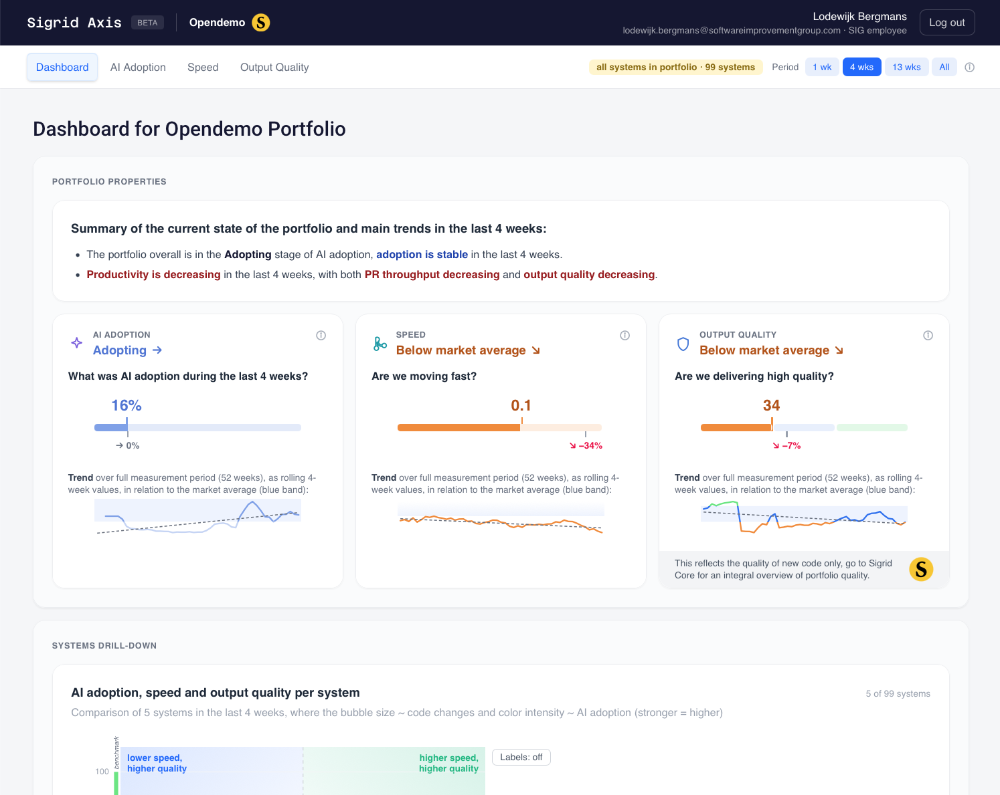

# Sigrid Axis Dashboard

AI coding assistants change how your teams build software. Sigrid Axis Dashboard shows what that change looks like across your portfolio: how much of your new code is AI-generated, how fast your teams deliver, and whether the quality of the new code holds up. In short, it answers the following questions, focusing on recent and long-term trends:

1. How far has AI generated code spread across our portfolio?
2. Are we delivering faster?
3. Is the quality of our new code holding up?
4. Which systems stand out, and where should we look first?

## Sigrid Core, Sigrid Axis, and Axis Dashboard

[Sigrid Core](../capabilities/portfolio-dashboard-plans.md) analyzes the current state of your complete source code and shows you the quality and risk profile of your systems. [Sigrid Axis](../axis/README.md) brings that analysis to AI coding agents, so agents work with your measured architecture and quality standards.

Sigrid Axis Dashboard is the portfolio view on the result. It does not analyze anything on its own. It combines the measurements Sigrid collects every week into three metrics per portfolio and per system:

* **AI adoption:** the share of [new and changed code](definitions.md#new-and-changed-code) that is AI-generated;
* **Speed:** the number of [pull requests](definitions.md#pull-request-pr) merged per [developer](definitions.md#developer) per week;
* **Output quality:** a benchmarked score for the maintainability, security, and reliability of the code your teams touched.

Speed and [output quality](definitions.md#output-quality) are compared against the [SIG benchmark](definitions.md#sig-benchmark). This tells you whether a metric is below, at, or above the [market average](definitions.md#market-average), so you do not have to guess whether a number is good.

<!-- TODO (product owner): how users open Axis Dashboard (link from Sigrid, direct URL) and which licenses it needs. -->

## How does Sigrid Axis Dashboard work?

Axis Dashboard does not analyze your code itself. Like Sigrid Core, it is built on the Sigrid Backbone: the same analysis and measurements that produce the results you see in Sigrid Core. Axis Dashboard shows a different view on the same data, aimed at how AI coding assistants change the way your teams build software.

This has a few consequences:

* **Systems must be onboarded in Sigrid first.** Only systems that are set up in Sigrid appear in Axis Dashboard. See [how to set up Sigrid](../organization-integration/onboarding-steps.md) and [mapping repositories to Sigrid systems](../organization-integration/systems.md).
* **The metrics are only as recent as your latest analysis.** Every metric covers whole weeks, so a system needs to be analyzed regularly to show what happened in the most recent weeks. The best way to do this is to run [Sigrid CI](../sigridci-integration/using-sigridci.md) as part of your pipeline, so Sigrid analyzes every change.
* **A system that is not updated shows gaps.** If Sigrid has no analysis for a system in a period, Axis Dashboard shows a dash instead of a metric. It does not mean zero.
* **Metrics and visuals depend on data availability.** For some portfolios, some data may not be available; e.g. long-term trends need a history of measurements, for some metrics there may not be a license, and for Speed-related metrics, the developer activity data gathering must be enabled.

## Contact and support

Feel free to contact [SIG's support team](mailto:support@softwareimprovementgroup.com) for any questions or issues you may have after reading this documentation or when using Sigrid.
