# The AI Adoption tab

The AI Adoption tab shows how much of the code your teams write is generated by AI, whether that share is growing, and which systems explain it. In short, it answers the following questions:

1. How much of our [new and changed code](definitions.md#new-and-changed-code) is [AI-generated](definitions.md#ai-generated-code), and is that growing?
2. How many systems use AI coding, and how much of the code base is AI-generated?
3. How has [AI adoption](definitions.md#ai-adoption) developed over time?
4. How are the systems spread over the adoption stages?
5. Which systems are accelerating, and which have stalled or are falling back?

These questions are answered in subsequent sections of the page:
* **Portfolio properties**: the key metrics of the portfolio, the weekly [trend](definitions.md#trend), and the systems per adoption stage.
* **Systems drill-down**: the landscape of the portfolio, and the list of systems with their metrics.

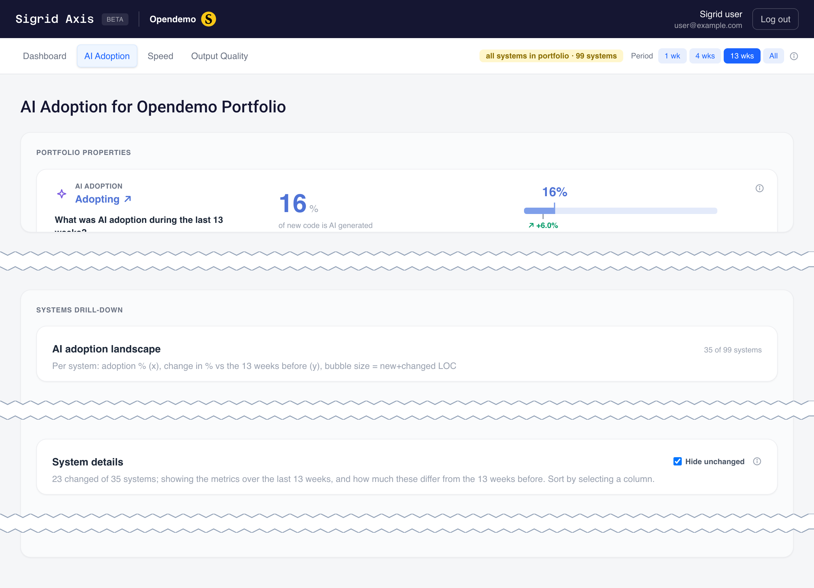

The following sections explain how to use and interpret the elements of the AI Adoption tab. All metrics, except the trend, cover the [period](definitions.md#period) you selected in the top bar, and are compared with the [period before](definitions.md#previous-period). See [Navigating Axis Dashboard](navigating.md) for the top bar, the period, and the [portfolio filter](definitions.md#portfolio-filter).

## 1\. Key metrics

Use the tiles to find out:  
_How much of the new code of my portfolio is AI-generated, how many systems use AI coding, and how does that compare with the period before?_
{: .faq }

The tiles have the same elements as the tiles of the Dashboard tab: a status, the question with its period, an info icon, a value, and the value of the period before. See [The Dashboard tab](dashboard.md#2-key-metrics) for what each element means. Below is what is specific to this tab.

### AI adoption

The top tile shows AI adoption: the share of new and changed code that is AI-generated, over all systems in the period. The status shows the [AI adoption stage](definitions.md#ai-adoption-stage) of your portfolio, with an arrow for the direction compared with the period before.

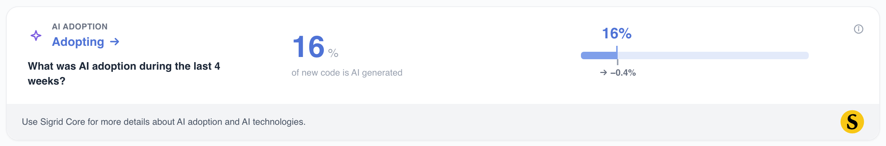

The bar behind the value shows the four stages, and a grey tick shows the share in the period before. The [change](definitions.md#change) is the difference between the two percentages. If adoption went from 20% to 26%, the change is +6%. A change smaller than 2.5% is [stable](definitions.md#stable). With the period [All](definitions.md#all) there is no stage arrow, no tick, and no change.

| Stage | AI-generated share of new and changed code |
|---|---|
| Exploring | Less than 10% |
| Adopting | From 10% up to 30% |
| Scaling | From 30% up to 60% |
| AI-native | 60% or more |

The link at the bottom of the tile opens Sigrid Core, see [Navigating Axis Dashboard](navigating.md#4-sigrid-core).

### The other tiles

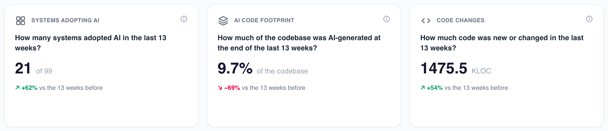

The three tiles below the top tile write their change as a relative change in %. If the number of systems went from 13 to 21, the change is +62%.

* **Systems adopting AI:** the number of systems with more than 10% AI adoption in the period, out of all systems of the portfolio. Only systems that have new or changed code in the period can count. The info icon also says how many systems had new or changed code to measure.
* **AI code footprint:** the share of all lines of code that is AI-generated, at the end of the period. Unlike AI adoption, this is not about the code of the period but about the whole code base, so it changes more slowly. The info icon gives the number of lines.
* **Code changes:** the number of new and changed lines of code in the period, in thousands of lines (KLOC). This is the amount of code that AI adoption is a share of. Removed lines are not counted.

When no new or changed code was measured in the period, the top tile says so instead of showing a value, and the other tiles show a dash.

## 2\. Trend

Use the trend to find out:  
_How has AI adoption developed over the last half year, and when did it change?_
{: .faq }

The chart *How is AI adoption trending?* shows the share of new and changed code that is AI-generated, for 26 weeks ending with the [last complete week](definitions.md#last-complete-week). It does not change with the period, but a bar under the week labels marks the selected period. For the period **All**, the bar covers the whole axis.

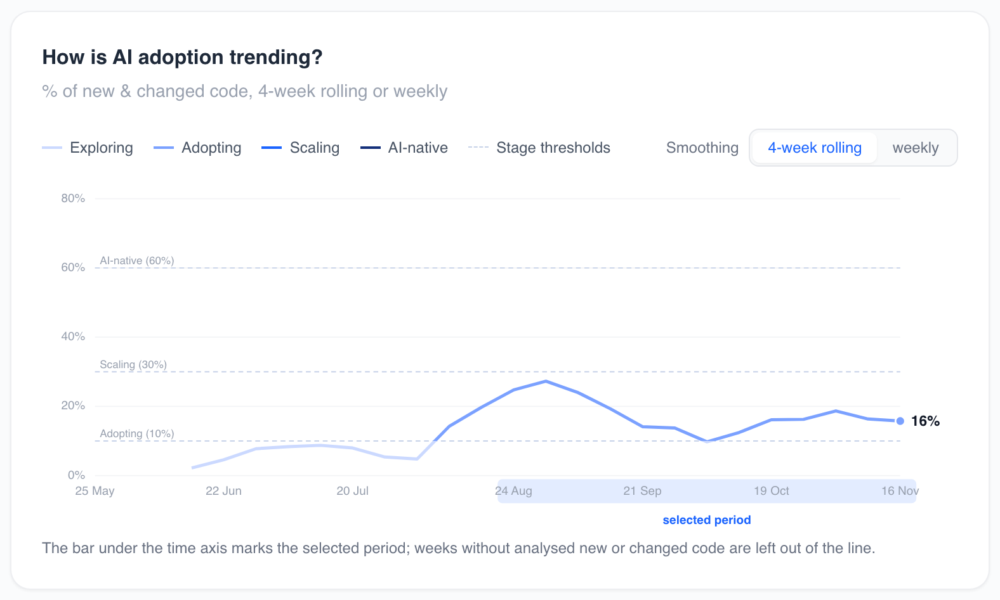

* **Line:** by default every point is the share over the 4 weeks ending in that week, so one unusual week does not dominate. The color of the line follows the stage of each point. Use **Smoothing** above the chart to switch to the weekly share.
* **Dashed lines:** the borders between the stages, at 10%, 30%, and 60%.
* **Last value:** the number at the end of the line is the share in the last week shown.
* **Hover:** point at a week to see its value.

A week without analyzed new or changed code breaks the line. It is never drawn as zero, because no new code does not mean that nobody used AI. Keep in mind that the value of a tile for a period is calculated over all code of that period, so it can differ from the line at the same moment.
{: .attention }

## 3\. Systems by AI adoption stage

Use the donut to find out:  
_How are my systems spread over the adoption stages, and which systems are in a given stage?_
{: .faq }

The chart *Systems by AI adoption stage* counts the systems per stage in the selected period. The total is in the middle, and the legend shows the number and share per stage.

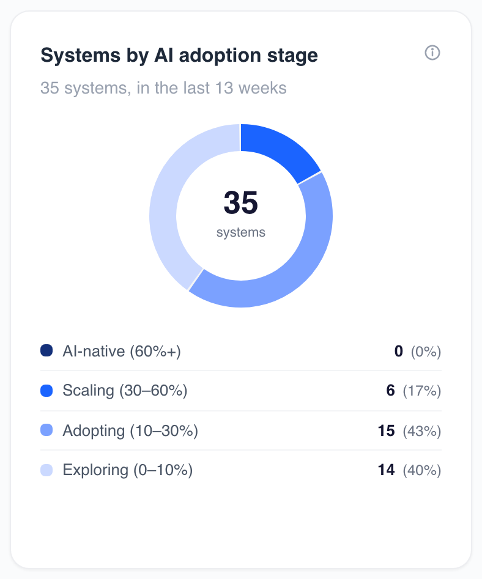

Only systems with new or changed code in the period have a stage. The card says how many systems have none, because they are not counted. Point at the info icon behind a stage to read its definition.

Select a stage, in the chart or in the legend, to set a portfolio filter on it. Every metric on every tab is then about the systems of that stage only, and the top bar shows the portfolio filter. The donut itself keeps showing the whole portfolio, with your stage highlighted. Select the stage again, or the **×** in the top bar, to clear the portfolio filter. A stage without systems cannot be selected.

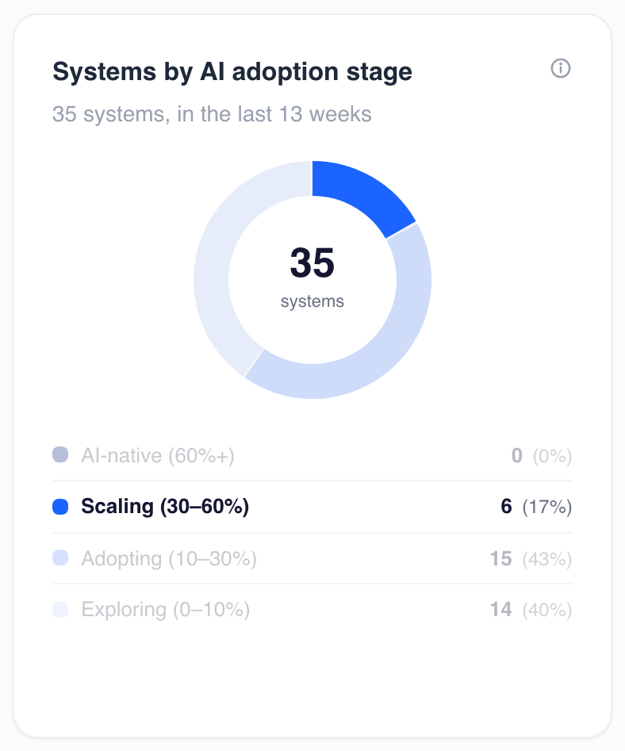

## 4\. AI adoption landscape

Use the landscape to find out:  
_Which systems have a high adoption and are still climbing, which are catching up, and which have stalled or are falling back?_
{: .faq }

The landscape is a [bubble chart](definitions.md#bubble-chart) that compares systems on AI adoption and on how adoption changed.

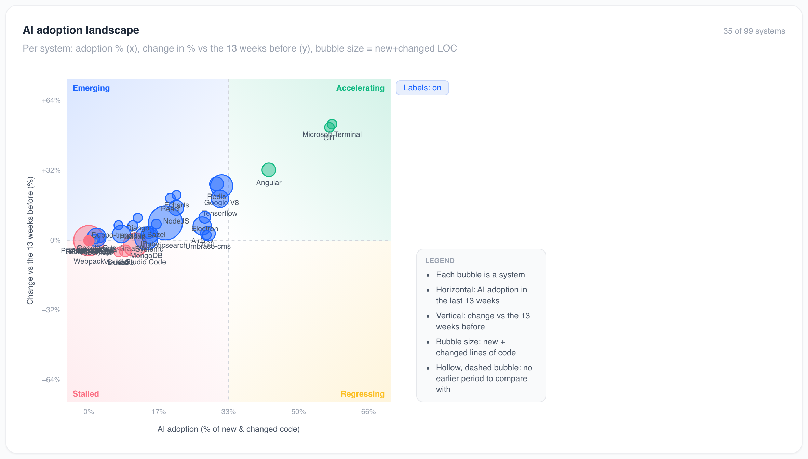

* **Each bubble is a system.** The header says how many systems are drawn, for example *35 of 99 systems*.
* **Horizontal:** AI adoption of the system in the period.
* **Vertical:** the change compared with the period before, as the difference of the two percentages. Systems that increased are above the middle line.
* **Bubble size:** the amount of new and changed code of the system in the period.
* **Color:** the quadrant the system is in, which is its signal.

The dashed dividers split the chart in four quadrants. The horizontal divider is at a change of 0. The vertical divider is halfway along the adoption axis, which ends just above the highest adoption in your portfolio. It is relative to the systems you see, so *high adoption* means high for your portfolio. It is not a benchmark value.

| Signal | Quadrant | Meaning |
|---|---|---|
| Emerging (blue) | Top left | Adoption is still low, but moving up |
| Accelerating (green) | Top right | High adoption, and still climbing |
| Stalled (rose) | Bottom left | Low adoption, with no increase |
| Regressing (amber) | Bottom right | High adoption, but falling back |

A [signal](definitions.md#ai-adoption-signal) only looks at the direction of the change. A system with a small increase, smaller than the 2.5% that counts as stable, still has the signal of a rising system.
{: .attention }

Select **Labels** to show the names of the systems. Hover over a bubble to see the adoption, the amount of code, and the change of the system. Select a bubble to open that system, see [Looking at one system](#6-looking-at-one-system).

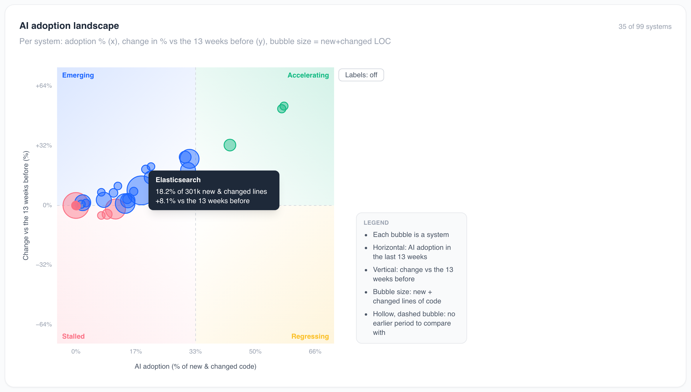

A system with no new or changed code in the period before has nothing to compare with. It is drawn as a hollow bubble with a dashed outline on the middle line and has no signal. For the period **All**, every bubble is hollow.

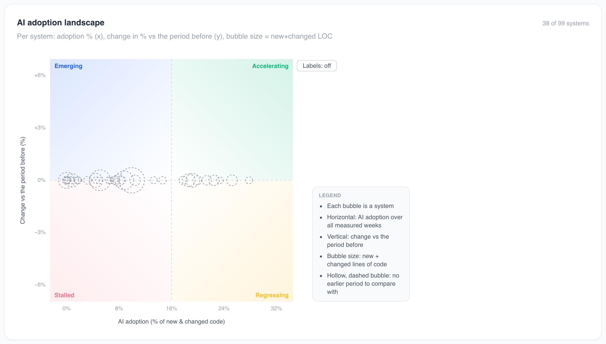

Systems without new or changed code in the period are not drawn, so the number of bubbles is smaller than the number of systems. The chart draws at most the 60 systems with the most new and changed code. The header then shows a smaller number than the number of systems in the list, without further notice. The list below is not limited.
{: .attention }

## 5\. System details

Use the list to find out:  
_Which systems changed most in AI adoption, which systems have the highest or lowest adoption, and how does a specific system compare with the rest?_
{: .faq }

The list shows every system that has new or changed code in the period, so you can look up a specific system and see how it differs from the rest.

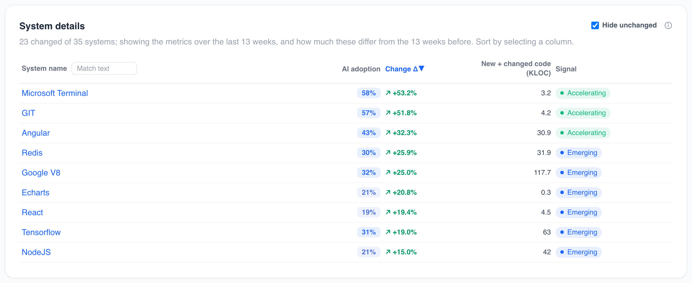

The columns are:

* **System name:** type in **Match text** to filter the list on part of a name, see [Filtering on system name](#filtering-on-system-name). Select a name to open that system.
* **AI adoption:** the share for the period, on a background in the color of its stage.
* **Change:** the difference with the period before, with an arrow. The column is empty for a system with no new or changed code in the period before, and for the period **All**.
* **New + changed code (KLOC):** the amount of new and changed code in the period, in thousands of lines.
* **Signal:** the quadrant of the landscape the system is in.

### Hide unchanged

The checkbox **Hide unchanged** is on by default. The list then only shows systems whose adoption changed by 2.5% or more, up or down, compared with the period before. Clear the checkbox to see every system. For the period **All** the checkbox has no effect, because there is nothing to compare with.

### Filtering on system name

Type part of a system name in **Match text** at the name column. The list then only shows systems whose name contains that text. The search ignores upper and lower case and looks at the name as shown in the list, not at the system ID.

The landscape follows what you type. Every system whose name matches gets a thick outline with a thin white ring on each side, and it is drawn on top of the other bubbles, so you can find it in a crowded chart. Clear the text to remove the outlines.

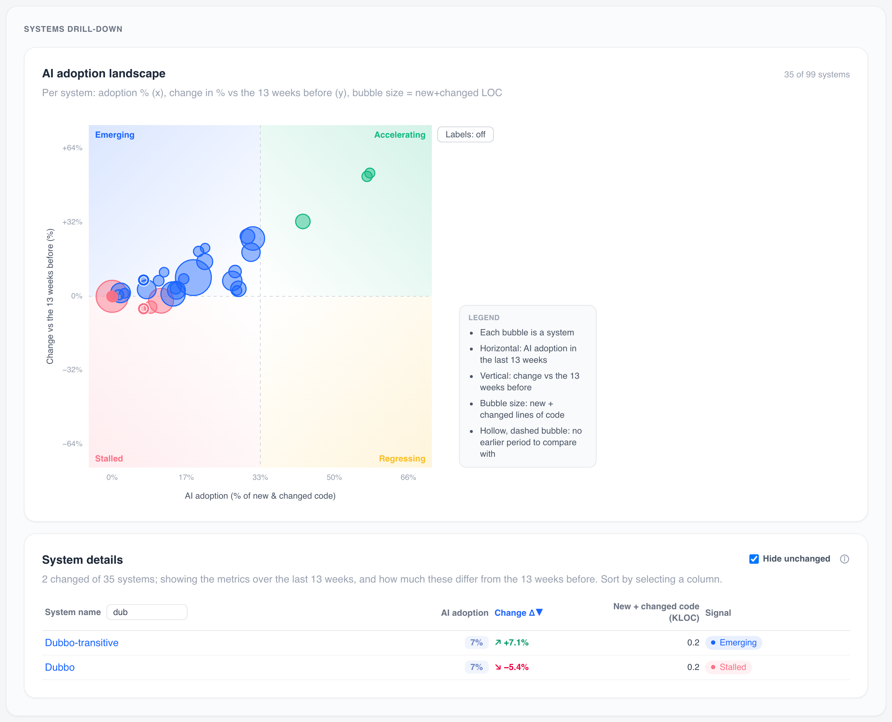

You can also select a row to outline its bubble. Select the row again to remove the outline. A selected system and the systems that match the text are outlined together.

* The outline also shows for matching systems that the list hides, for example because **Hide unchanged** is on.
* A system that has no bubble in the landscape cannot be outlined.
* The text and the selected row stay when you change the period.

### Sorting

The list opens sorted on the change in adoption, with the largest change first. Select a column header to sort on that column:

* **Name:** A to Z, and then Z to A.
* **Values:** high to low first, then low to high.
* **Change:** the largest change first, whichever way it went. A second click sorts high to low, and a third click low to high.
* **Signal:** A to Z.

Systems without a value always come last.

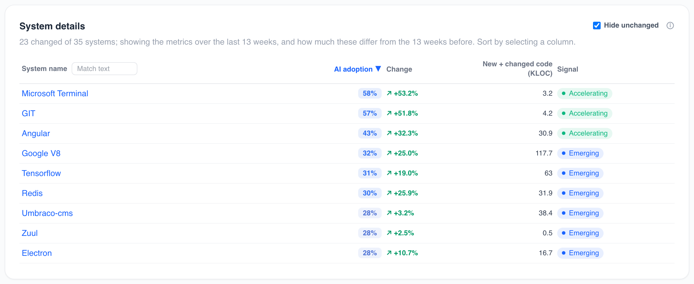

## 6\. Looking at one system

Use the page of a system to find out:  
_How much of the code of this system is AI-generated, and how did that develop?_
{: .faq }

Select a system name in the list, or a bubble in the landscape, to open the AI Adoption tab for that system. [Navigating Axis Dashboard](navigating.md#3-looking-at-one-system) explains how to move between a system and the portfolio. A system page shows:

* **The top tile:** AI adoption of the system, with its stage and its change.
* **Adoption stage:** the stage of the system, with its range and its signal in the info icon.
* **Code changes:** the amount of new and changed code of the system.
* **The trend** of the system.

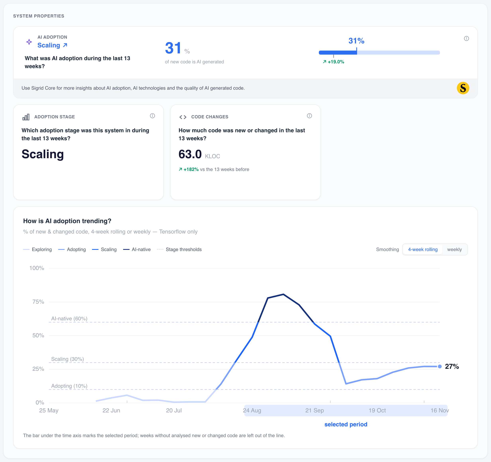

The systems adopting AI, the AI code footprint, the stages chart, the landscape, and the list are only available for the portfolio. A portfolio filter does not apply to a system.

## When data is missing

If your organization is not licensed for AI adoption data, the tab shows a notice instead of the metrics: *AI adoption data is not part of your licence, so it is not shown.* A portfolio or system for which Sigrid has no AI adoption data shows *Adoption data unavailable*.

Weeks in which no new or changed code was analyzed leave a gap in the trend, and systems without such code in the period have no stage. Use the [Data availability](dashboard.md#5-data-availability) section of the Dashboard tab to see how many systems have AI-generated code detected.

## Contact and support

Feel free to contact [SIG's support team](mailto:support@softwareimprovementgroup.com) for any questions or issues you may have after reading this documentation or when using Sigrid.
