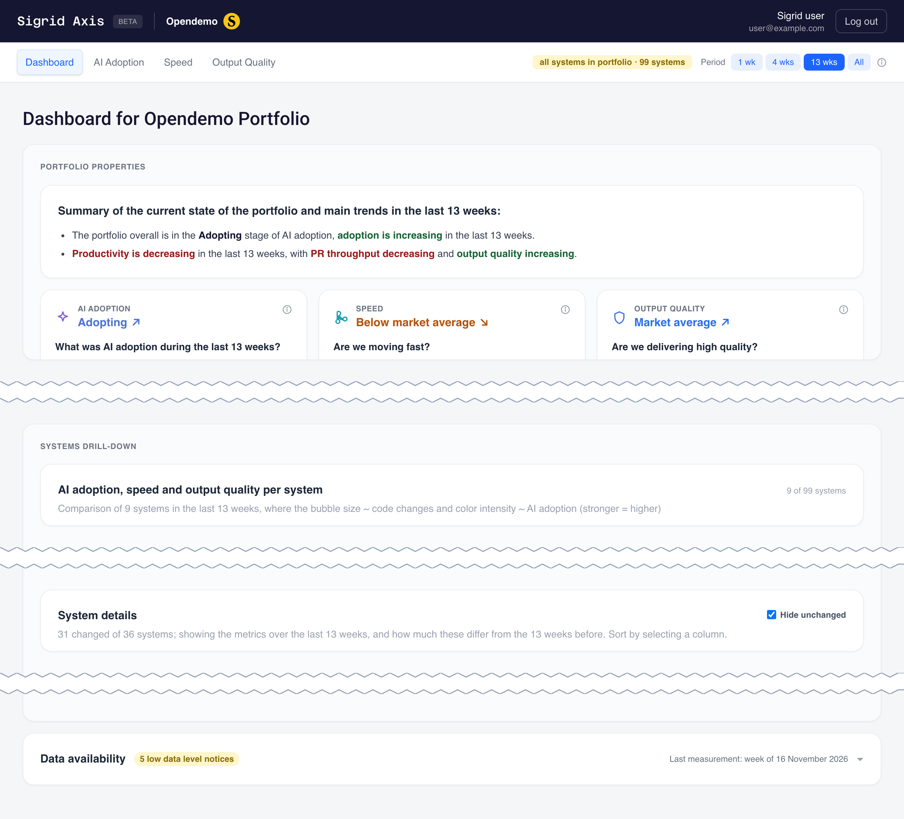
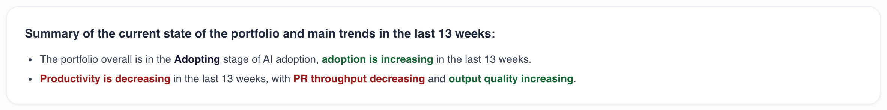
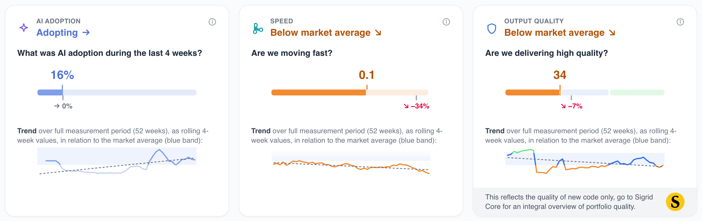
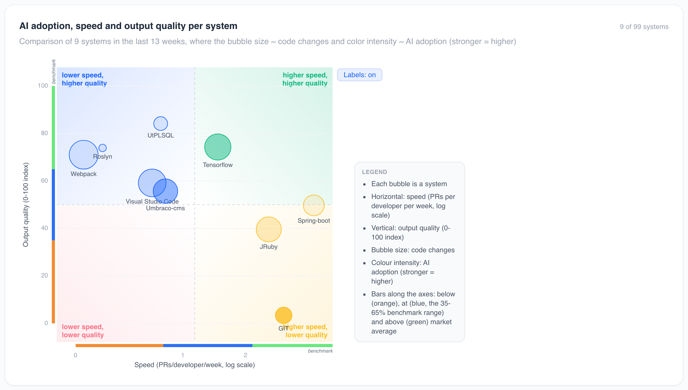
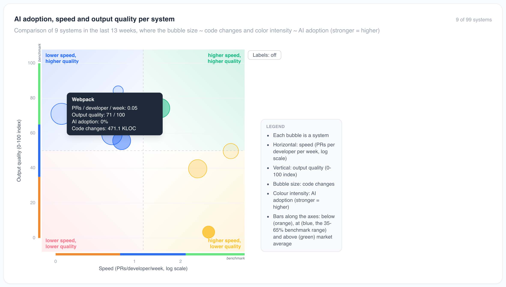
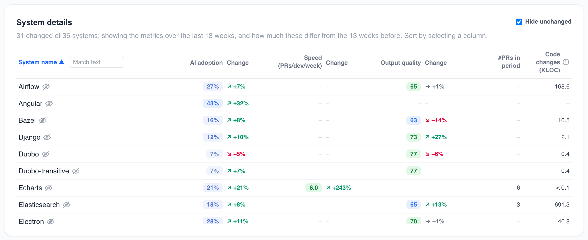
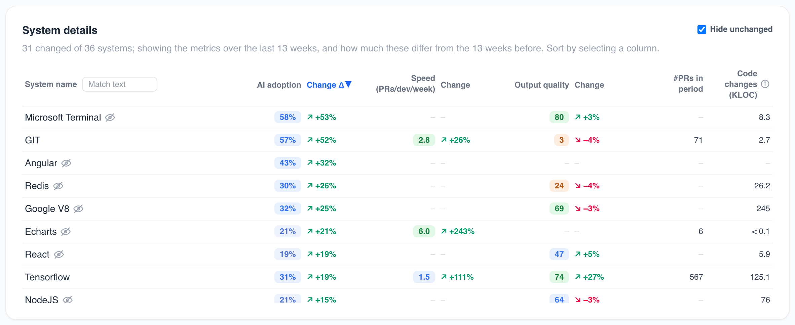
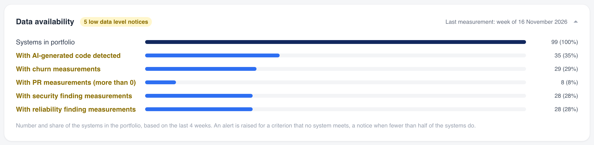

# The Dashboard tab

The Dashboard tab is where you start in Sigrid Axis Dashboard. It summarizes [AI adoption](definitions.md#ai-adoption), [speed](definitions.md#speed), and [output quality](definitions.md#output-quality) of your portfolio in one view, and shows which systems stand out. In short, it answers the following questions:

1. Where does our portfolio stand on AI adoption, speed, and output quality?
2. Is that getting better or worse compared with before?
3. Which systems explain these metrics, and which differ from the rest?
4. Which system (metrics) changed most in the recent period?
5. Is the presented data influenced by missing or partial data?

These questions are answered in subsequent sections of the page:
* **Portfolio properties**: a summary and key [trends](definitions.md#trend) for the 3 aspects AI adoption, Speed, and Output Quality.
* **Systems drill-down**: show the landscape of the portfolio, and how systems differ for these 3 aspects.
* **System details**: review and sort the key metrics and how they changed recently.
* **Data availability**: check to what extend data sources are missing or incomplete.

The following sections explain how to use and interpret the elements of the Dashboard tab.

## 1\. Portfolio summary

The summary describes the state of your portfolio in two sentences, for the selected period.

* **AI adoption:** the stage your portfolio is in, and whether adoption is increasing, [stable](definitions.md#stable), or decreasing compared with the [period before](definitions.md#previous-period).
* **Productivity:** whether productivity is increasing, stable, or decreasing. Productivity combines speed (*PR throughput*) and output quality. It is decreasing if either one decreases. Otherwise it is increasing if either one increases. The sentence says *both* when the two move in the same direction.

The trend words are colored: green for increasing, blue for stable, red for decreasing. When there is no earlier period to compare with, for example with the period **All**, the summary only gives the [AI adoption stage](definitions.md#ai-adoption-stage). When a [portfolio filter](definitions.md#portfolio-filter) is on, the summary speaks about the *filtered portfolio*.

Use the summary to find out:  
_What is the state of my portfolio, and is it moving in the right direction?_
{: .attention }

## 2\. Key metrics

Use the tiles to find out:  
_How does AI adoption, speed, and output quality of my portfolio compare with the market, and with the period before?_
{: .faq }

One tile per key metric: **AI adoption**, **Speed**, and **Output quality**. Select a tile to open the tab with more detail.

This screenshot uses the 4-week period. Each tile has the same elements, from top to bottom:

* **Status:** the name of the metric, its zone, and an arrow. The zone is the stage (AI adoption) or *below*, *at*, or *above [market average](definitions.md#market-average)* (speed and output quality). The arrow shows whether the metric is increasing, stable, or decreasing compared with the period before. Hover over the arrow for the comparison period.
* **Question:** what the tile answers, including the period.
* **Info icon:** the definition of the metric. Hover over it to read how the metric is calculated.
* **Metric value:** the metric for the selected period, above a marker on a colored bar. The bar shows where the value lies compared with the zones.
* **Metric value previous period:** a grey tick on the bar shows the value in the period before. The change is written below it, with an arrow. There is no tick for the period **All**.
* **Trend:** a small line chart, [described below](#trendline).

### AI adoption

The share of [new and changed code](definitions.md#new-and-changed-code) that is AI-generated, over all systems in the period. Sigrid adds up the lines of [AI-generated code](definitions.md#ai-generated-code) and the lines of all new and changed code over all systems and all weeks of the period. It does not average the weekly percentages.

The change is the difference between the two percentages. If adoption went from 20% to 26%, the change is +6%.

The stage depends on how large that share is:

| Stage | AI-generated share of new and changed code |
|---|---|
| Exploring | A small minority. AI coding is used occasionally. |
| Adopting | A growing share. AI coding is in regular use, but most new code is still written without it. |
| Scaling | A large share. AI coding is a standard part of how your teams work. |
| AI-native | The majority of new and changed code. |

A percentage exactly on the border between two stages belongs to the higher stage.

### Speed

The number of [pull requests](definitions.md#pull-request-pr) merged per [developer](definitions.md#developer) per week, over all systems. The number is a total of the pull requests of all systems, divided by the number of distinct developers of the portfolio in each week. A developer who works on several systems counts once.

Only [active systems](definitions.md#active-system-speed) count. A system is active when it merged more than a handful of pull requests in the 13 weeks ending with the selected period. This is the same for every period, so selecting a short period does not shrink the set of systems.

Sigrid retrieves pull request data when developer activity is enabled for [Architecture Quality](../capabilities/architecture-quality.md). Without it, the Speed metrics are not available.

The zone compares the metric with the [SIG benchmark](definitions.md#sig-benchmark) of pull requests per active developer per week: below, at, or above the market average. The change is relative to the period before. If speed went from 0.2 to 0.1, the change is −50%.

When a portfolio filter is on, the Speed tile shows a red exclamation icon. The speed of a group of systems cannot be compared with the market or with the complete portfolio, because only a complete portfolio has a count of unique developers across all systems.
{: .attention }

### Output quality

A score from 0 to 100 for the maintainability, security, and reliability of the code your teams changed in the period. Each score is benchmarked against the SIG benchmark. The overall score is the average of the scores that are available for your portfolio. A score in the middle band of the benchmark counts as *at the market average*. A score below that band is *below the market average*, and a score above it is *above the market average*.

The change is the difference between the two scores, written in %. If the score went from 42 to 34, the change is −8%.

The score describes new and changed code only. It does not replace the quality ratings of the complete system. The link at the bottom of the tile opens Sigrid Core for the integral overview.
{: .attention }

### Trendline

The line under each tile shows how the metric developed over all measured weeks, independent of the selected period. Every point is the metric over the 4 weeks ending in that week, so one unusual week does not dominate. The color of the line follows the zone of each point. The blue band behind the line is the market average for speed and output quality, and the highlighted stage for AI adoption. The dashed grey line is the overall direction (a linear regression over the entire period).

A week without data breaks the line. It is never drawn as zero. A line needs at least two values.

The trend of speed adds up the pull requests of every system that has data in a given week. The tile only counts active systems. The last point of the trend can therefore differ slightly from the value of the tile.
{: .attention }

### How "stable" is decided

An arrow is flat when the change is small. Small changes are normal fluctuation, so they do not count as a trend. The same rule decides which systems count as changed in the [system list](#4-system-details).

## 3\. System landscape

Use the bubble chart to find out:  
_Which systems deliver fast and with good quality, and which are slow or low in quality? Which systems are outliers?_
{: .faq }

The system landscape [bubble chart](definitions.md#bubble-chart) compares systems on speed and output quality, with AI adoption as color intensity.

* **Each bubble is a system.** The header says how many systems are drawn, for example *5 of 99 systems*.
* **Horizontal:** speed, in pull requests per developer per week, on a logarithmic scale.
* **Vertical:** output quality, from 0 to 100.
* **Bubble size:** the amount of [code changes](definitions.md#code-changes) of the system in the period.
* **Color intensity:** AI adoption. The more intense the color, the higher the share of AI-generated code.
* **Color:** the quadrant the system is in.
* **Bars along the axes:** the market average zones, below in orange, at in blue, above in green.

The dashed dividers split the chart in four quadrants. The horizontal divider is at an output quality of 50. The vertical divider is halfway along the speed axis of this portfolio, so it is relative to the systems you see. It is not a benchmark value.

| Quadrant | Meaning |
|---|---|
| Top left (blue) | Lower speed, higher quality |
| Top right (green) | Higher speed, higher quality |
| Bottom left (rose) | Lower speed, lower quality |
| Bottom right (amber) | Higher speed, lower quality |

Select **Labels** to show the names of the systems. Hover over a bubble to see the metrics of the system.

A system is only drawn when speed, output quality, and AI adoption are all measured in the period. Speed also needs an active system. The number of bubbles is therefore smaller than the number of systems, and shorter periods show fewer bubbles. Systems that cannot be drawn are marked in the system list.
{: .attention }

## 4\. System details

Use the list to find out:  
_Which systems metrics changed most in the period, what are the systems with top/bottom metric values, and how does a specific system compare with the rest?_
{: .faq }

The list shows the metrics for every system, so you can look up a specific system and see how it differs from the rest. the `#PRs in period` and `Code changes (KLOC)` columns also give you an indication of how much change there was in the system in the selected period.

The columns are:

* **System name:** type in **Match text** to filter the list on part of a name, see [Filtering on system name](#filtering-on-system-name).
* **AI adoption**, **Speed**, and **Output quality:** the value for the period, on a background in the color of its zone. Hover over a value to see the zone. Each is followed by a **Change** column, with an arrow, compared with the period before.
* **#PRs in period:** the number of pull requests merged by the system.
* **Code changes (KLOC):** the lines touched (added, changed, or removed) in the period, in thousands of lines.

A dash means the system has no value for that metric in the period. Speed is only available for active systems, so many systems have a dash there.

A system with a grey eye icon with a slash behind its name is not drawn in the bubble chart, because one of the metrics it needs is missing in the period. Hover over the icon for the reason.

### Hide unchanged

The checkbox **Hide unchanged** is on by default. The list then only shows systems where at least one of the three metrics is increasing or decreasing compared with the period before. Clear the checkbox to see every system with data in the period. For the period **All** the checkbox has no effect, because there is nothing to compare with.

### Filtering on system name

Type part of a system name in **Match text** at the name column. The list then only shows systems whose name contains that text. The search ignores upper and lower case and looks at the name as shown in the list, not at the system ID.

The bubble chart follows what you type. Every system whose name matches gets a thick outline with a thin white ring on each side, and it is drawn on top of the other bubbles, so you can find it in a crowded chart. Clear the text to remove the outlines.

You can also select a row to outline its bubble. Select the row again to remove the outline. A selected system and the systems that match the text are outlined together.

* The outline also shows for matching systems that the list hides, for example because **Hide unchanged** is on.
* A system that has no bubble, because a metric it needs is missing in the period, cannot be outlined. It is marked with the grey eye icon in the list.
* The text and the selected row stay when you change the period.

### Sorting

The list opens sorted on system name. Select a column header to sort on that column:

* **Name:** A to Z, and then Z to A.
* **Values:** high to low first, then low to high.
* **Change:** the largest change first, whichever way it went. A second click sorts high to low, and a third click low to high.

Systems without a value always come last.

## 5\. Data availability

Use the data availability to find out:  
_How much of my portfolio is behind these metrics, and what data is missing?_
{: .faq }

The bottom of the page shows how much data is behind the metrics. Select **Data availability** to expand it.

For the selected period, the section counts the systems per kind of data:

* **Systems in portfolio:** all active systems.
* **With AI-generated code detected:** systems where Sigrid found AI-generated code.
* **With churn measurements:** systems with changed code in the period.
* **With PR measurements (more than 0):** systems with merged pull requests.
* **With security finding measurements** and **With reliability finding measurements:** systems where Sigrid measured security or reliability findings.

Next to the title you see a badge, such as *5 low data level notices*. A **notice** means that fewer than half of the systems have that kind of data. An **alert** means that no system has it. The metrics on the page are less representative when a [notice](definitions.md#notice-and-alert) or alert applies to the data behind them.

A kind of data that your organization is not licensed for shows **Not licensed** instead of a count, and is not counted as an alert. The tabs that need this data show a notice at the top of the page.

The right of the title shows the last week that is included in the metrics.

## Contact and support

Feel free to contact [SIG's support team](mailto:support@softwareimprovementgroup.com) for any questions or issues you may have after reading this documentation or when using Sigrid.
