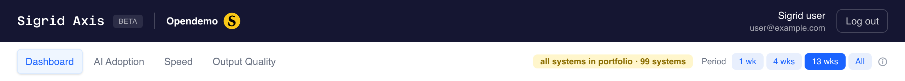
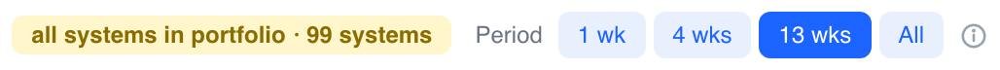
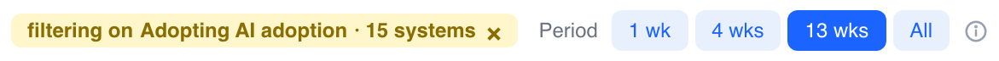
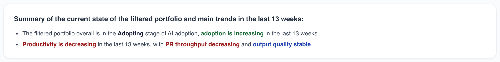
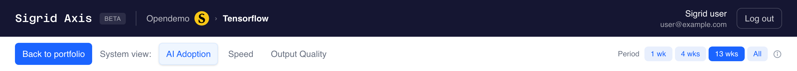

# Navigating Axis Dashboard

Every page of Sigrid Axis Dashboard has the same top bar. It lets you switch tab, choose the period you look at, and set a [portfolio filter](definitions.md#portfolio-filter) on a group of systems. This page explains those controls and how to move between the portfolio and a single system.

## 1\. Period

The **Period** buttons set the length of the period that every metric on the page covers: **1 wk**, **4 wks** (the default), **13 wks**, or **All**.

* **Current period:** the weeks you selected, ending with the [last complete week](definitions.md#last-complete-week). The week that is still in progress is never included.
* **Comparison:** each metric is compared with the period of the same length directly before it. With a period of 4 weeks, the metrics cover the last 4 weeks and are compared with the 4 weeks before that.
* **All:** covers all measured weeks. There is no earlier period to compare with, so there are no changes, no arrows, and no markers for a previous value.

Select the (i) icon next to the buttons to see the exact weeks.

A period of 1 week is allowed but noisy. A single bulk merge or a holiday week can move a metric a lot, and many systems have no value in a single week.
{: .attention }

The period applies to the whole page, and to all tabs. It is part of the address of the page, so you can share a link that opens on the same period.

## 2\. Portfolio filter

The yellow box shows which systems the metrics are about. By default it says **all systems in portfolio**, followed by the number of systems.

You set a portfolio filter on one of the "Systems by ..." charts on the AI Adoption, Speed, or Output Quality tab. Select a category in the chart, for example the *Scaling* stage or *Above market average*, and the box changes to the portfolio filter you set:

From then on, every metric on every tab is about the systems in that category only. The chart where you set the portfolio filter still shows the whole portfolio, with your category highlighted. Select the **×** in the box, or select the category again, to clear the portfolio filter.

The portfolio filter is a category, not a fixed list of systems. If you change the period, the portfolio filter keeps its category and picks up the systems that belong to it in the new period. A portfolio filter that no system matches in the new period is cleared.

On the Dashboard tab, the summary then speaks about the *filtered portfolio*:

The [speed](definitions.md#speed) of a filtered group of systems cannot be compared with the market or with the complete portfolio. The Speed tile shows a red exclamation icon to remind you of this.
{: .warning }

## 3\. Looking at one system

Select a system name in a list, or a bubble in a chart, to see the same metrics for that system only. The page then shows:

* **Breadcrumb:** the portfolio name, followed by the system name.
* **Back to portfolio:** returns to the same tab of the portfolio.
* **System view:** the tabs available for a system. The Dashboard tab is not offered, because a system has nothing to compare with.
* **Period:** works as before.

Note that currently you cannot zoom into a single system from the Dashboard page.
{: .attention }

A portfolio filter you set on the portfolio does not apply when you open a system, the selected period is kept.

## 4\. Sigrid Core

The Sigrid mark next to the portfolio name opens the same portfolio in Sigrid Core. Some tiles have a link at the bottom with a Sigrid mark, for a more complete view of the same subject. A link is grey when your organization has no license for the capability it opens.

## Contact and support

Feel free to contact [SIG's support team](mailto:support@softwareimprovementgroup.com) for any questions or issues you may have after reading this documentation or when using Sigrid.
