# The Output Quality tab

The Output Quality tab shows how good the code is that your teams changed in the selected period. It scores the [new and changed code](definitions.md#new-and-changed-code) for maintainability, security, and reliability against the [SIG benchmark](definitions.md#sig-benchmark), and combines these scores into one overall index. In short, it answers the following questions:

1. How high is the quality of the code we deliver, compared with the market?
2. Is that getting better or worse compared with before?
3. Which of maintainability, security, and reliability pulls the [output quality](definitions.md#output-quality) down?
4. How are our systems spread over below, at, and above [market average](definitions.md#market-average)?
5. Which systems deliver high quality, and how much code do they change?
6. Which systems changed most in the recent period?

These questions are answered in subsequent sections of the page:
* **Portfolio properties**: the key metrics, how they developed over the past year, and how the systems are spread over the market zones.
* **Systems drill-down**: the landscape of the portfolio, and the list of systems with their scores.

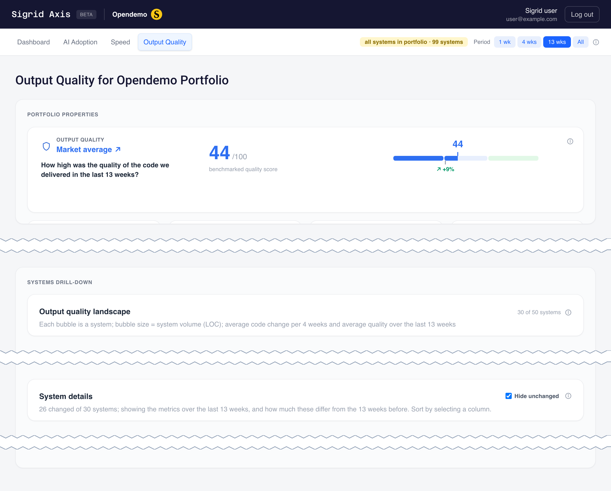

The following sections explain how to use and interpret the elements of the Output Quality tab.

## 1\. Key metrics

Use the tiles to find out:  
_How high is the quality of the code we delivered in the period, how does it compare with the market, and is it getting better or worse?_
{: .faq }

The top tile shows the overall quality. Below it, one tile each shows maintainability, security, and reliability, and a tile for architecture that is not available yet. [The Dashboard tab](dashboard.md#2-key-metrics) explains what every tile consists of: the status, the question, the info icon, the metric with its marker on a colored bar, and the tick for the previous period. This section only explains what is specific to this tab.

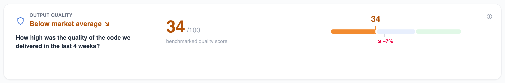

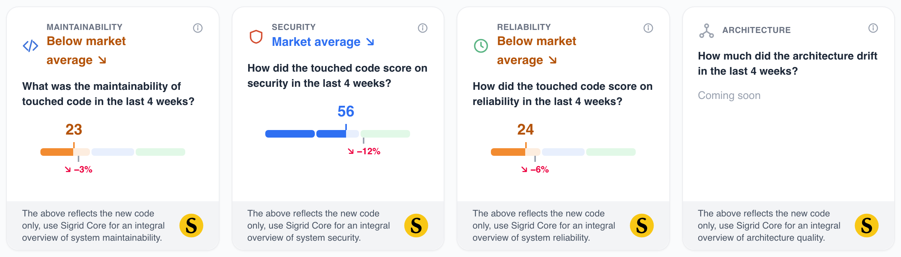

The screenshots use the 4-week period. The tiles cover the selected [period](definitions.md#period) and are compared with the [previous period](definitions.md#previous-period). With the period **All** there is no tick for a previous score and no change.

Output quality describes the code your teams changed in the period. It does not replace the quality ratings of the complete system. The link at the bottom of each quality tile opens the matching page in Sigrid Core for the integral overview.
{: .attention }

### Overall quality

The top tile shows the overall quality index, a score from 0 to 100. It is the average of the scores of maintainability, security, and reliability that are available for your portfolio. A quality that is not measured, for example because of a missing license, is left out of the average. It is never counted as zero.

The zone tells you where the score lies compared with the market: *below*, *at*, or *above* market average. The colored bar shows the three zones: orange below, blue at, and green above.

### Maintainability, security, and reliability

Each of the three tiles shows the [quality score](definitions.md#quality-score) of one quality, from 0 to 100. A higher score is better.

* **Maintainability:** the score is based on the [maintainability rating](definitions.md#maintainability-rating) of the new and changed code, compared with the SIG benchmark. It is labelled an *industry percentile*.
* **Security** and **Reliability:** the score is based on the [finding density](definitions.md#finding-density), the number of new findings per thousand lines of changed code. If there are no new findings the score is 100. Otherwise the score is lower the more findings there are, compared with benchmark systems with a similar amount of change. It is labelled a *benchmark score*, because it is not a percentile of the whole market.

Hover over the info icon of a tile to see what it measures. The info icon also shows the **measured value** behind the score, for example *2.1 ★* for maintainability, or *0.35 findings/KLOC* for security, and how that value changed compared with the previous period.

### Score changes

The change below the bar is the difference between the two scores, written in %. If the maintainability score went from 26 to 23, the change is −3%. It is the [change](definitions.md#change) of a score, not a relative change: a score that moves from 12 to 74 reads +62%.

The change of the measured value in the info icon is a relative change, so it can look different. For findings, a rise is bad: security findings per KLOC that rise by 37% read +37% there, while the score goes down.

An arrow is flat when the change is [stable](definitions.md#stable). The tile and its arrow follow the same rules as the other tabs.

### Architecture

The Architecture tile is a placeholder, with the text *Coming soon*. Architecture drift is not measured yet and is not part of the overall quality index.

### Qualities that are not available

If a quality has no measurements for your portfolio, its tile says *Not available* and the page shows a notice at the top. The overall index then combines the other qualities.

### Same value as the trend

With the default period of 4 weeks, the value of each tile equals the last point of the lines in the [trend](#2-quality-trend). With another period, a tile covers its own period, while the trend always uses 4 weeks, so the two can differ.

## 2\. Quality trend

Use the trend to find out:  
_How did the quality of the code we deliver develop over the past year, and which quality explains the changes?_
{: .faq }

The card *How are the quality scores trending?* shows one line per quality, and one for the overall quality index, over the last 52 weeks up to the [last complete week](definitions.md#last-complete-week). The lines do not depend on the selected period.

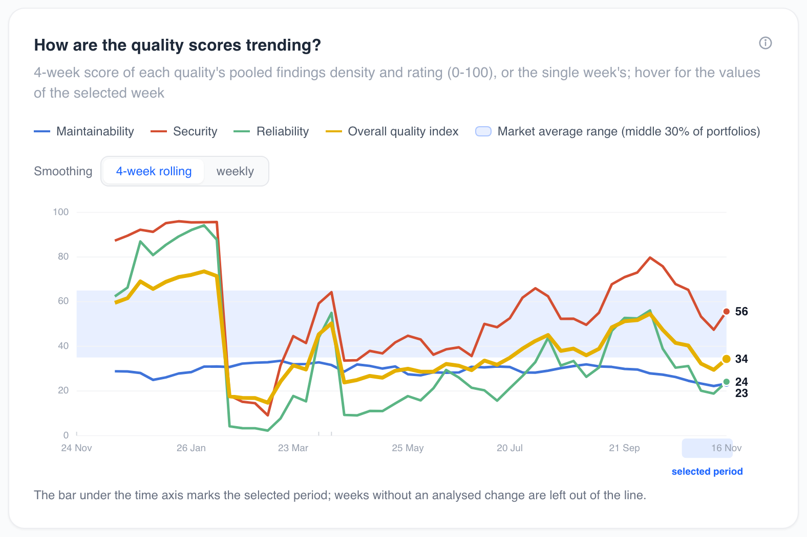

* **Lines:** maintainability (blue), security (red), reliability (green), and the overall quality index (yellow, drawn on top). The value at the end of each line is the latest score.
* **Vertical axis:** the score, from 0 to 100.
* **Blue band:** the market average range, from a score of 35 to 65.
* **Bar under the time axis:** the selected period. For **All** it covers the whole axis.
* **Smoothing:** **4-week rolling** shows for each week the score of that week and the three weeks before it. It is the default. **Weekly** shows the score of each week on its own, which is more erratic.

Hover over the chart to see, for the selected week and per quality, the score and the measured value: the star rating for maintainability, and the findings per KLOC for security and reliability.

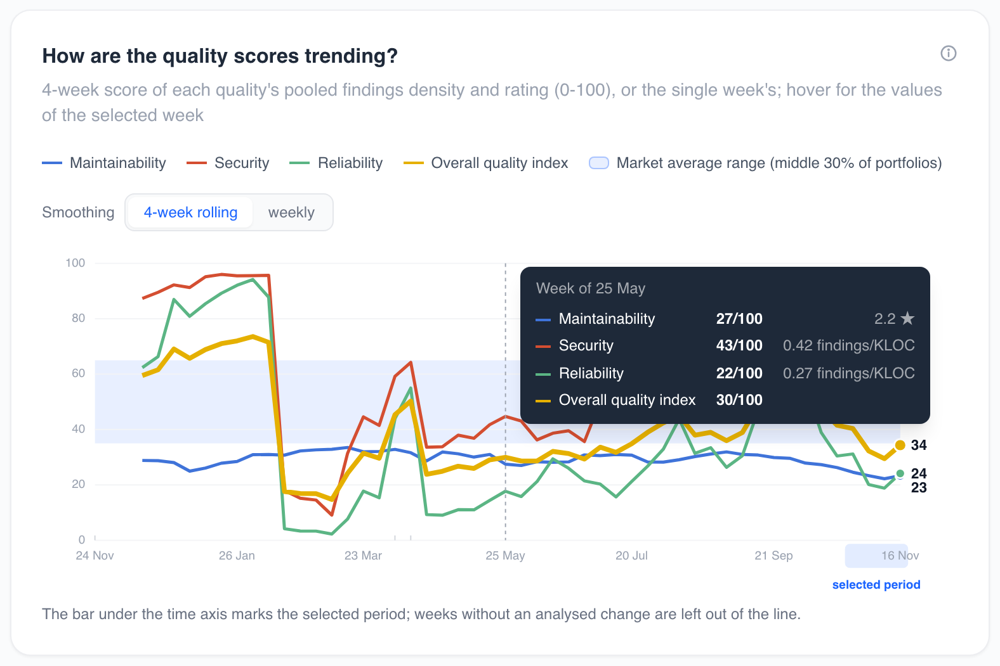

The 4-week score is the score of the total of those 4 weeks: all new findings over all changed code. It is not the average of the weekly scores.

A week without an analysis of changed code has no score, so the line breaks. It is never drawn as zero, because a score of 0 means *worst in the benchmark*. A 4-week point with hardly any analyzed code change and no findings has no score either.
{: .attention }

When a [portfolio filter](definitions.md#portfolio-filter) of *Not measured* or *Inactive* is on, the card says that there are no systems with sufficient measurements to display a trend line.

## 3\. Systems by output quality

Use the chart to find out:  
_How many of my systems are above, at, or below market average, and how many cannot be rated?_
{: .faq }

The donut shows how the systems of your portfolio are spread over the zones, for the selected period. The number in the middle is the total number of systems. It always shows the whole portfolio, also when a portfolio filter is on. The category of the portfolio filter is then highlighted and the others are faded.

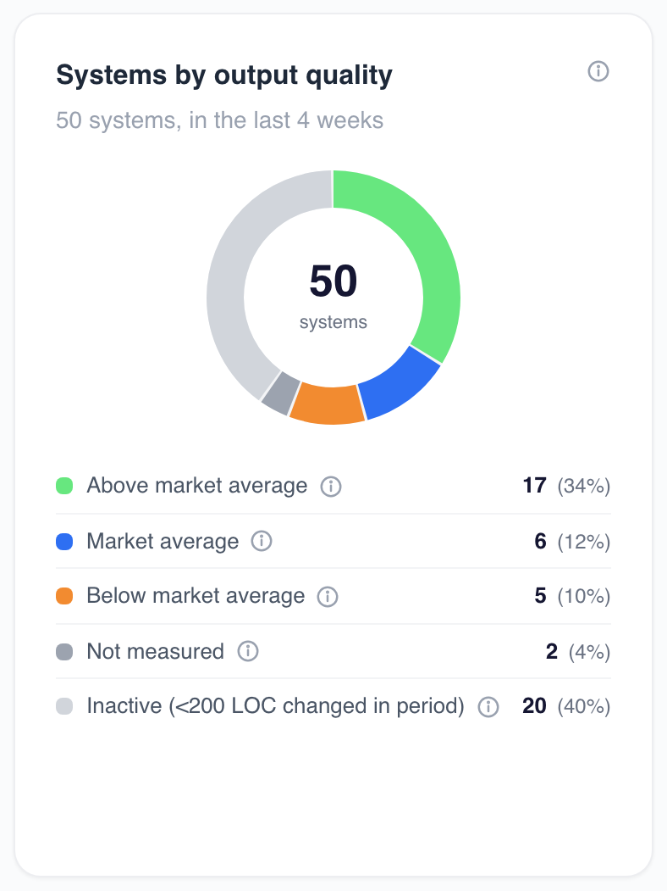

Each row shows the number of systems, and their share of the portfolio:

| Category | Systems that |
|---|---|
| Above market average | have an overall quality score above the market average range for the period. |
| Market average | have an overall quality score within the market average range. |
| Below market average | have an overall quality score below the market average range. |
| Not measured | changed enough code, but no analysis measured it in the period. This row only shows while a system is in it. |
| Inactive | changed too little code to be rated fairly, see below. |

Hover over the info icon of a row to read its definition.

Select a segment or a row to set a portfolio filter on that category: every metric on every tab is then about those systems only. Select it again to clear the portfolio filter. A category without systems cannot be selected. See [Navigating Axis Dashboard](navigating.md#2-portfolio-filter).

A system is [inactive](definitions.md#inactive) when it changed less than 200 lines of code in the 13 weeks ending with the last week of the period. This is the same for every period, so selecting a short period does not make more systems inactive. The scores of such systems are too extreme to rank them, so they are counted in the total, but not rated. See [active system](definitions.md#active-system-output-quality).
{: .attention }

## 4\. Output quality landscape

Use the landscape to find out:  
_Which systems deliver high quality, and how much code do they change? Which systems change a lot, with low quality?_
{: .faq }

The landscape is a [bubble chart](definitions.md#bubble-chart) that compares systems on the amount of code they change and on one of the qualities.

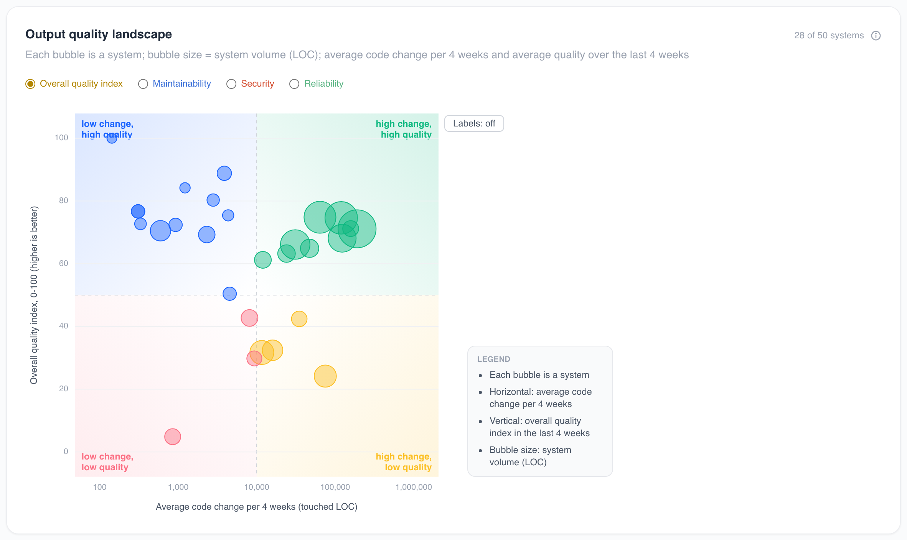

* **Each bubble is a system.** The header says how many systems are drawn, for example *28 of 50 systems*.
* **Horizontal:** the average [code change](definitions.md#code-changes) per 4 weeks over the period, in lines of code, on a logarithmic scale.
* **Vertical:** the quality you select, see below.
* **Bubble size:** the [system volume](definitions.md#system-volume). The sizes stay the same when you select another quality.
* **Color:** the quadrant the bubble is in.

The dashed dividers split the chart in four quadrants of equal size, at the middle of both axes. They are relative to the systems you see. They are not benchmark values.

| Quadrant | Meaning |
|---|---|
| Top left (blue) | Little code change, high quality |
| Top right (green) | Much code change, high quality |
| Bottom left (rose) | Little code change, low quality |
| Bottom right (amber) | Much code change, low quality |

Select **Labels** to show the names of the systems. Hover over a bubble to see the system, its quality, its code change per 4 weeks, and its volume. Select a bubble to open the system.

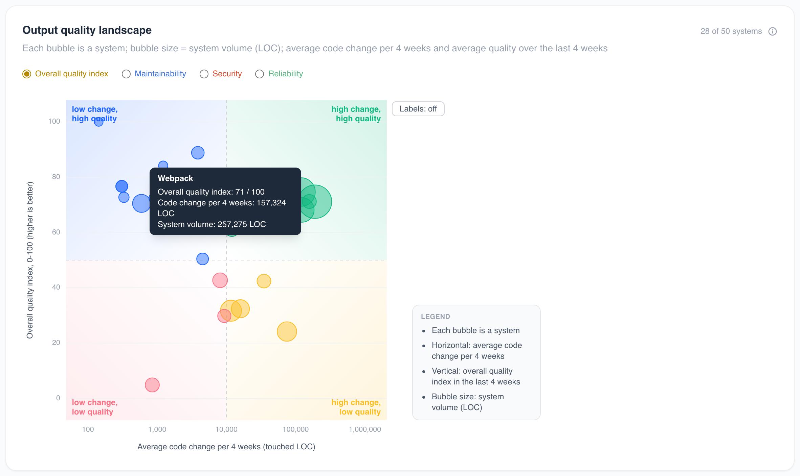

The landscape has no period selector of its own. It follows the period you selected at the top of the page.

### Choosing the quality

Select the quality for the vertical axis above the chart:

| Quality | Vertical axis | Better is |
|---|---|---|
| Overall quality index | The overall quality score, from 0 to 100. | Higher, at the top |
| Maintainability | The star rating of the changed code. | Higher, at the top |
| Security | The new security findings per KLOC of code change. | Lower, so at the top |
| Reliability | The new reliability findings per KLOC of code change. | Lower, so at the top |

For security and reliability the axis runs from the top down, so that high quality is always at the top of the chart. Below the chart you can switch the vertical axis between **Log** (the default) and **Linear**. The log axis spreads systems with few findings, so they do not all cluster at the top.

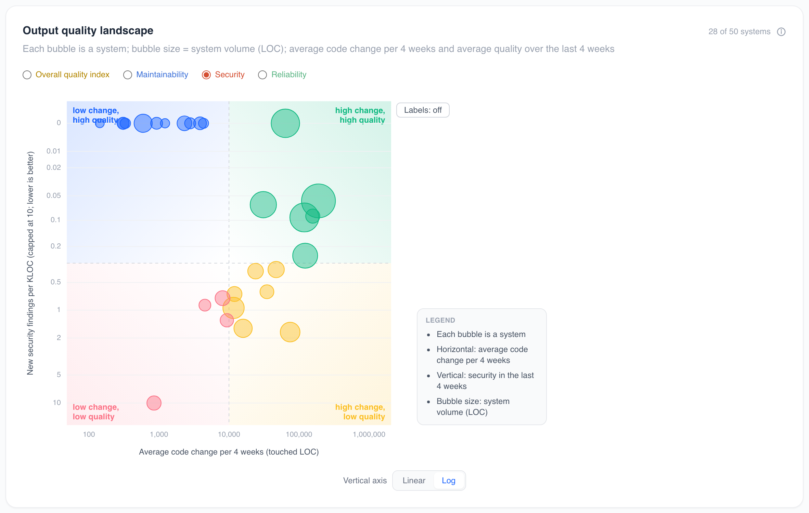

The finding axis stops at 10 findings per KLOC. A system with more findings is drawn on the border of the axis, as far down as the chart goes. Hover over its bubble to see the real value.
{: .attention }

A system is only drawn when it has code change in the period and a value for the quality you selected. The number of bubbles is therefore smaller than the number of systems. The landscape also draws systems that are inactive in the donut and the list, as long as they changed some code in the period. Their scores are based on little code and can be extreme.
{: .attention }

## 5\. System details

Use the list to find out:  
_Which systems changed most in output quality in the period, which systems score highest and lowest, and how does a specific system compare with the rest?_
{: .faq }

The list shows the output quality of the systems that are rated, so you can look up a specific system and see how it differs from the rest. It uses the same list as the other tabs, so sorting and filtering work the same.

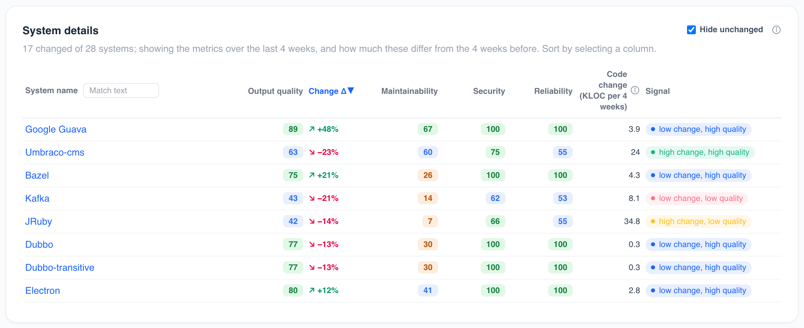

The list contains the systems that are not inactive and have an overall score in the period. The columns are:

* **System name:** type in **Match text** to filter the list on part of a name, see [Filtering on system name](#filtering-on-system-name).
* **Output quality:** the overall quality score for the period, on a background in the color of its zone.
* **Change:** the difference between the score and the score in the previous period, written in %, with an arrow. The change is calculated over the qualities that have a score in both periods, so a quality that is measured for the first time does not count as an improvement. A system without code change in the previous period has no change. With the period **All** no system has a change.
* **Maintainability**, **Security**, and **Reliability:** the score of each quality for the period, in the color of its zone. A quality that your portfolio has no measurements for has no column. A dash means the system has no score for that quality.
* **Code change (KLOC per 4 weeks):** the average number of lines touched per 4 weeks, in thousands of lines. It is also the horizontal position in the landscape.
* **Signal:** the quadrant of the landscape the system is in, for example *low change, high quality*.

The list opens sorted on the size of the change.

### Hide unchanged

The checkbox **Hide unchanged** is on by default. The list then only shows systems whose output quality is increasing or decreasing compared with the previous period, which means a stable change is hidden. Clear the checkbox to see every system that is rated. For the period **All** the checkbox has no effect.

### Filtering on system name

Type part of a system name in **Match text** at the name column, and the list only shows the systems whose name contains that text. The landscape follows what you type: every system that matches gets a thick outline with a white ring on each side, and is drawn on top of the other bubbles. Select a row to outline its bubble as well. Select the row again to remove the outline.

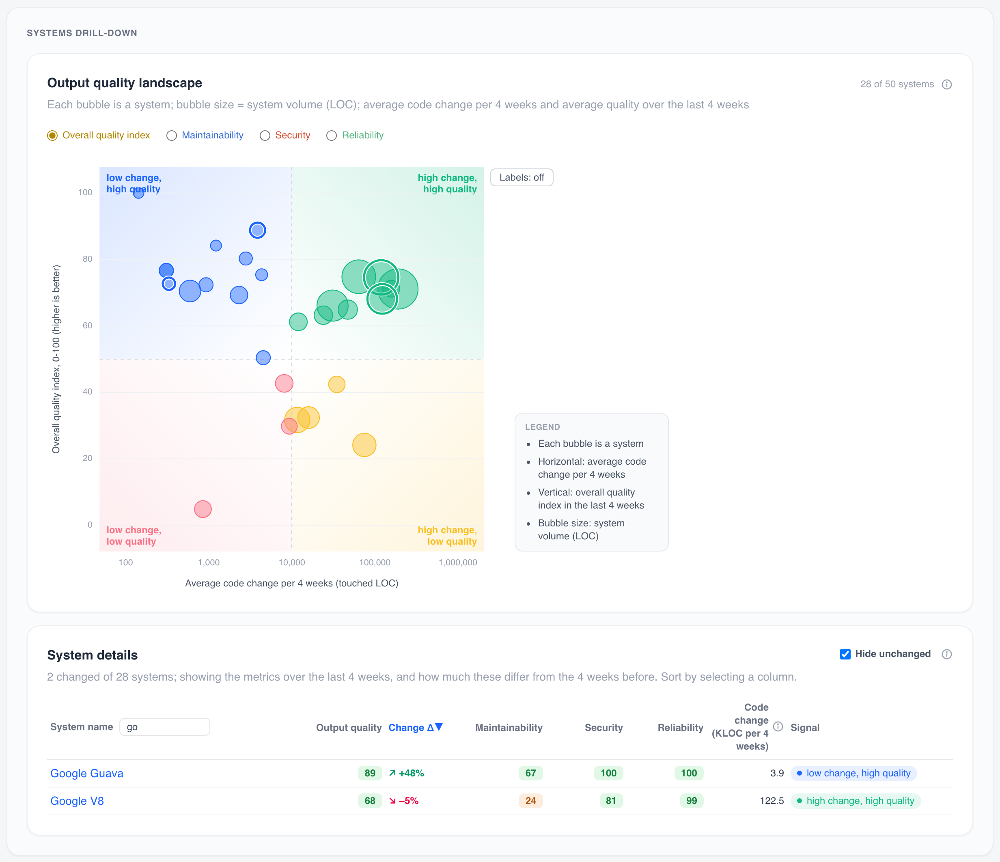

* The outline also shows for matching systems that are hidden by **Hide unchanged**.
* Only systems in the list can be outlined. A system that is not rated, for example an inactive system that still has a bubble in the landscape, has no row, so it cannot be found this way.
* The text and the selected row stay when you change the period.

### Sorting

Sorting works as on the [Dashboard tab](dashboard.md#sorting): select a column header to sort on that column. Systems without a value always come last.

## 6\. One system

Use the page of a system to find out:  
_How good is the code this system delivers, and how did that develop?_
{: .faq }

Select a system in the list, or a bubble in the landscape, to see Output Quality for that system only. [Navigating Axis Dashboard](navigating.md#3-looking-at-one-system) explains how to move between the portfolio and a system.

A system has the tiles, with the links to the page of that system in Sigrid Core, and the trend. The donut, the landscape, and the list compare systems, so they are only shown for the portfolio. The tiles and the trend use the same rules as for a portfolio.

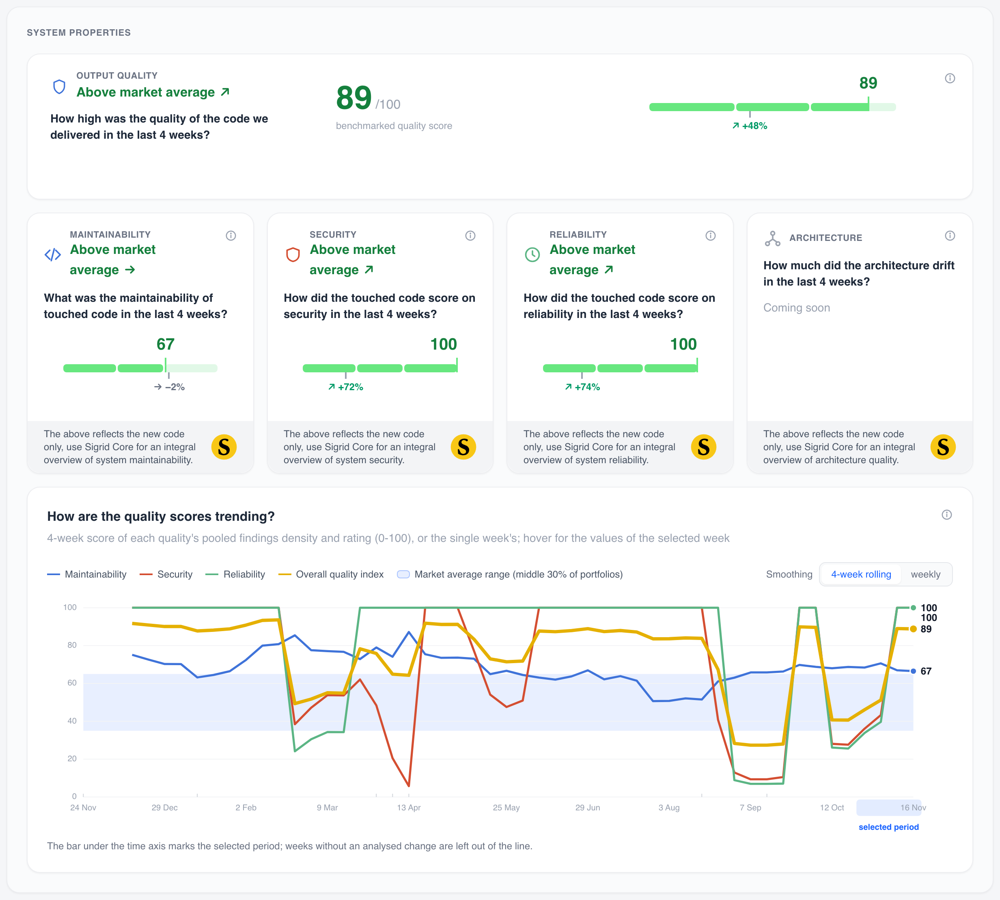

If the system changed no code in the period that Sigrid analyzed, the tiles show a dash and the text *No code change measured against the benchmark*. Select a longer period, or another system.

## Contact and support

Feel free to contact [SIG's support team](mailto:support@softwareimprovementgroup.com) for any questions or issues you may have after reading this documentation or when using Sigrid.
