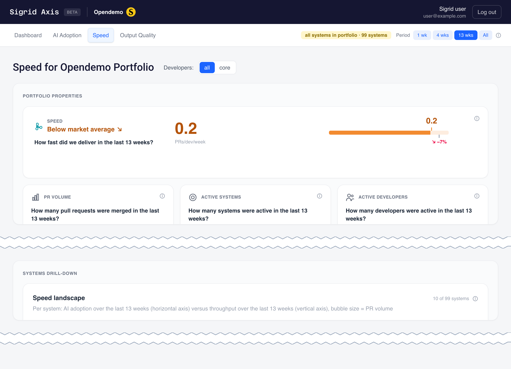
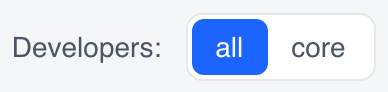
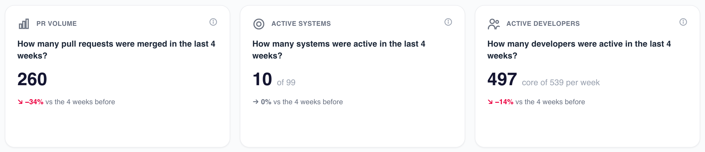
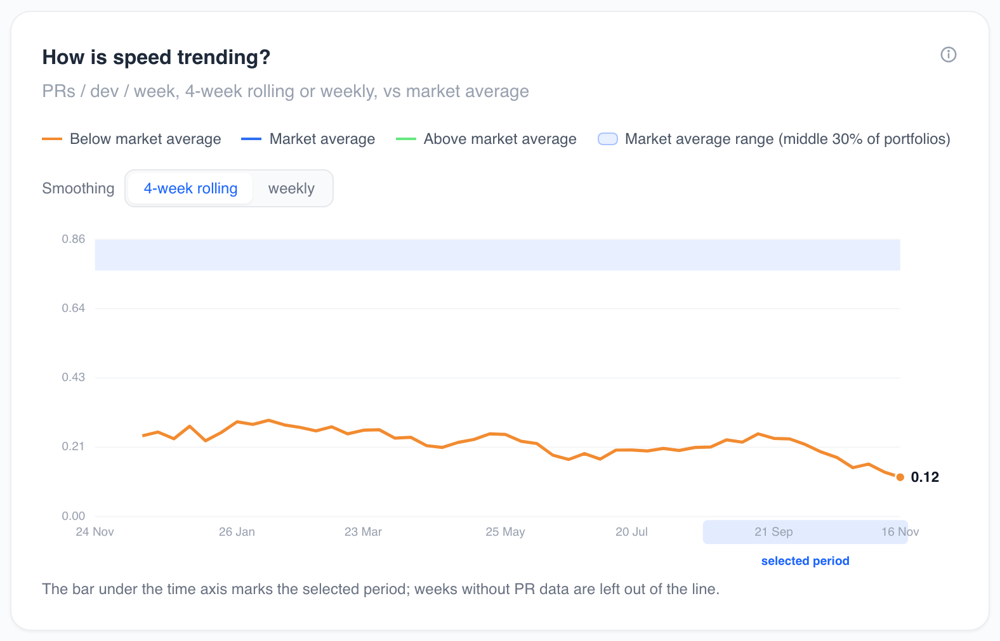
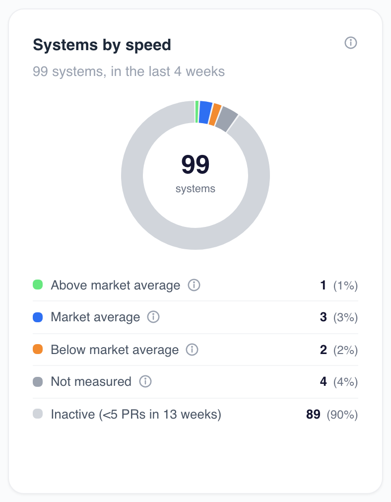
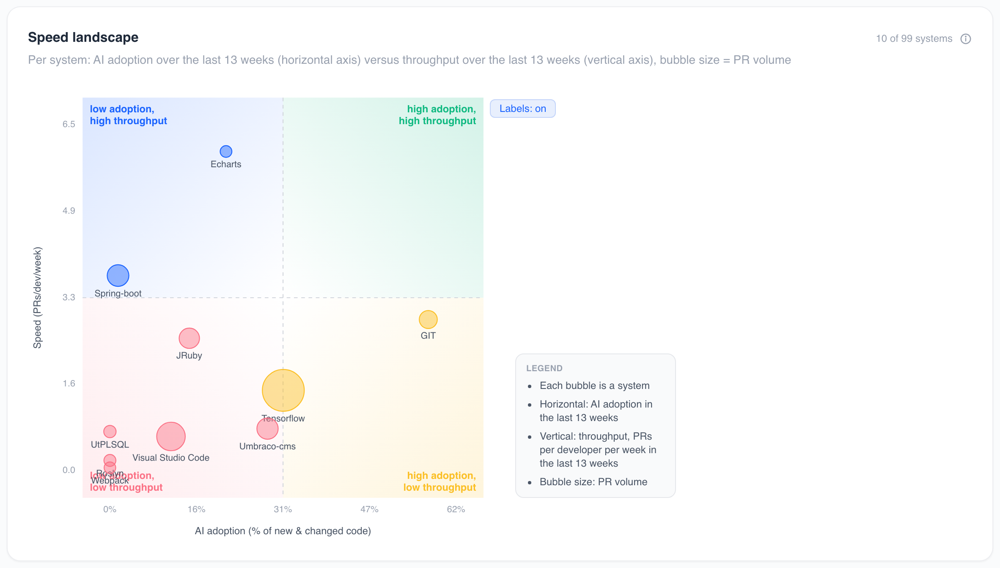
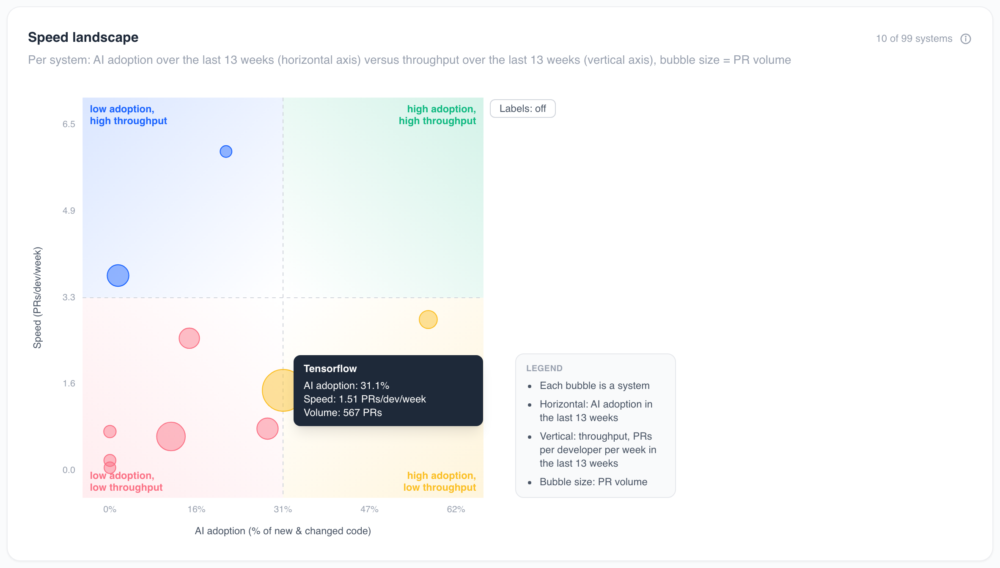
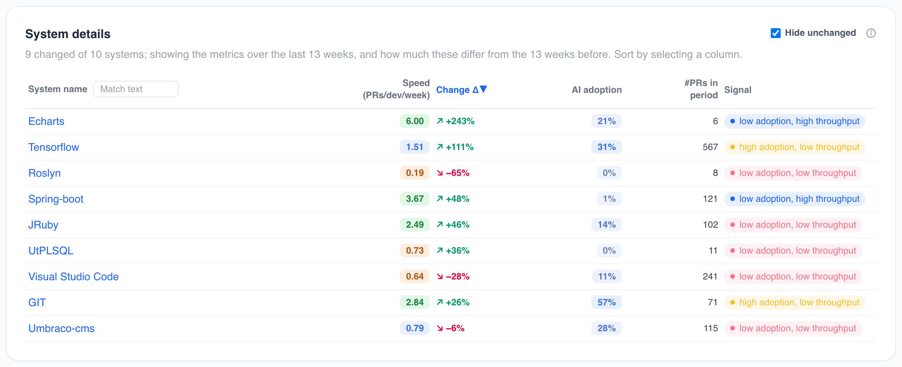
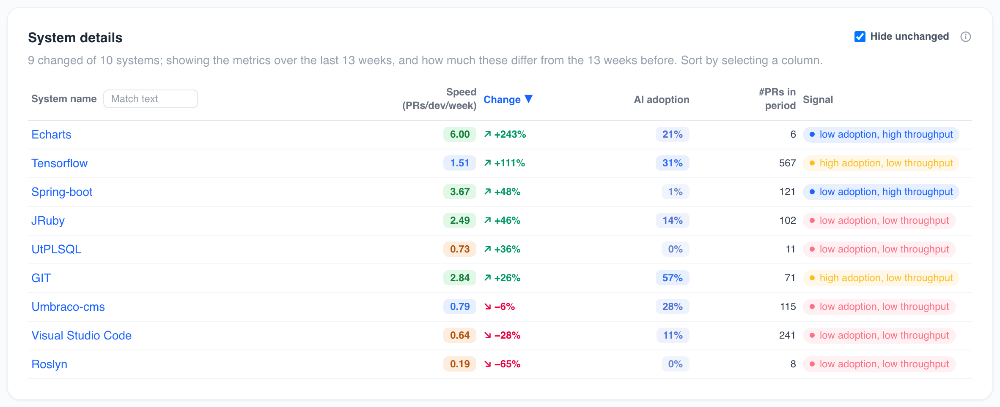
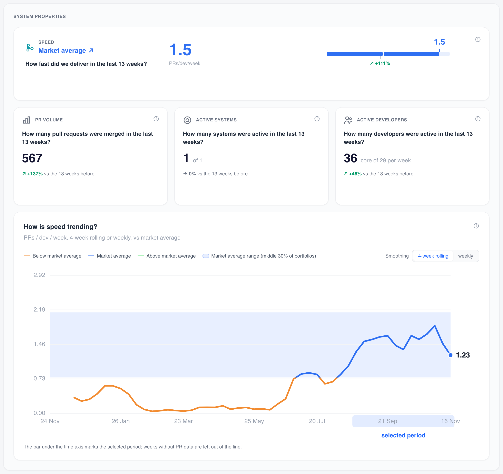

# The Speed tab

The Speed tab shows how fast your teams deliver. [Speed](definitions.md#speed) is the number of [pull requests](definitions.md#pull-request-pr) merged per [developer](definitions.md#developer) per week. The tab compares it with the [SIG benchmark](definitions.md#sig-benchmark), shows how it developed, and shows which systems are fast, slow, or too quiet to rate. It also relates speed to [AI adoption](definitions.md#ai-adoption) per system. In short, it answers the following questions:

1. How fast does our portfolio deliver, compared with the market and with the period before?
2. How many pull requests are merged, and how many systems and developers are behind that?
3. How did speed develop over the past year?
4. Which systems are above, at, or below the market average, and which are too inactive to rate?
5. Do the systems with more AI adoption also deliver faster?
6. Which systems changed most in the selected period?

These questions are answered in subsequent sections of the page:
* **Portfolio properties**: the key metrics, the trend over time, and the number of systems per speed category.
* **Systems drill-down**: the landscape of your systems, and the list of systems with their metrics.

The following sections explain how to use and interpret the elements of the Speed tab. The period, the portfolio filter and the view of a single system work as described in [Navigating Axis Dashboard](navigating.md).

## 1\. Developers: all or core

Use the **Developers** switch to find out:  
_Does speed look different when I only count the developers who contribute regularly?_
{: .faq }

At the top of the page, next to the title, you choose which developers speed is divided by:

* **all:** every developer who committed in the week. A developer who works on several systems counts once for the portfolio. This is the default.
* **core:** only the [core developers](definitions.md#core-developer).

The choice applies to the whole Speed tab: the speed itself, the zones, the trend, the number of systems per category, the landscape, and the list. Speed is then compared with the benchmark for the same kind of developers, so the zones can differ between the two choices. The choice is not part of the address of the page, and the other tabs do not use it.

The [portfolio filter](definitions.md#portfolio-filter) always uses the categories of **all**. You can only set it from the *Systems by speed* chart when **all** is selected.

## 2\. Key metrics

Use the tiles to find out:  
_How fast did we deliver in the period, how does that compare with the market and with the period before, and how much activity is behind it?_
{: .faq }

The Speed tab shows four tiles. They have the same elements as the tiles of the Dashboard tab, described under [Key metrics](dashboard.md#2-key-metrics).

### Speed

The large tile at the top shows the speed of your portfolio in the selected [period](definitions.md#period), as the number of pull requests per developer per week (PRs/dev/week). Sigrid adds up the pull requests and the weekly developer counts of all weeks in the period before it divides them, so a busy week counts for more than a quiet one.

Only [active systems](definitions.md#active-system-speed) count. A system is active when it merged at least 5 pull requests in the 13 weeks ending with the selected period. This is the same for every period, so selecting a short period does not shrink the set of systems.

The zone in the status line says whether speed is *below*, *at*, or *above* the [market average](definitions.md#market-average). The bar shows the market average band, and a grey tick shows the speed of the [previous period](definitions.md#previous-period). The [change](definitions.md#change) is a relative change in %: if speed went from 0.2 to 0.1, the change is −50%. Open the info icon to see which period and which benchmark are used.

A period of one week is a noisy basis for speed: one large merge or a holiday moves it. The info icon of the tile says so. Select 4 or 13 weeks for a more reliable reading.
{: .attention }

When a portfolio filter is on, the Speed tile shows a red exclamation icon. The speed of a group of systems cannot be compared with the market or with the complete portfolio, because only a complete portfolio has a count of unique developers across all systems. For a group of systems, Sigrid sums the developer counts of the systems, so a developer who works on several of them counts once for each.
{: .attention }

Sigrid does not use every week of every system. A week in which a system has an exceptional number of pull requests per developer, compared with all other system-weeks in the portfolio, is left out of speed, because it would distort the metric. This is not shown on the page.
{: .attention }

### PR volume

The total number of pull requests merged by the active systems in the period, compared with the period before. This is a count, not a rate, so it grows with the length of the period.

### Active systems

The number of active systems, out of all systems in your portfolio, for example *10 of 99*. The change compares the number with the number of active systems in the period before. Systems that are not active are [inactive](definitions.md#inactive) and are not rated on speed.

### Active developers

The average number of core developers per week in the period, next to the average number of all developers who committed, for example *497 core of 539 per week*. The change is the change of the core developers compared with the period before. This tile does not depend on the choice between **all** and **core**. With a portfolio filter on, it shows a red exclamation icon too, because developer counts of a group of systems cannot be compared with the counts of the complete portfolio.

## 3\. How is speed trending?

Use the trend to find out:  
_How did speed develop over the past year, and when was it below or above the market average?_
{: .faq }

The [trend](definitions.md#trend) shows speed per week for the last 52 weeks, independent of the selected period.

* **Line:** by default every point is the speed over the 4 weeks ending in that week. Use the **Smoothing** control to switch between **4-week rolling** and **weekly**. The 4-week line starts when four weeks of data are available.
* **Color of the line:** the zone of that part of the line: orange below, blue at, and green above the market average.
* **Band:** the market average range, drawn behind the line. On the chart the band can extend above the top of the vertical axis, when your speed is far below it.
* **Last value:** the label at the end of the line.
* **Selected period:** the bar under the time axis marks the weeks of the selected period. For the period **All** the bar covers the whole axis.

A week without data breaks the line. It is never drawn as zero. Every system with pull request data in a week takes part, not only the active systems. The last point of the trend can therefore differ slightly from the Speed tile.
{: .attention }

When the portfolio filter is *Not measured* or *Inactive*, the trend is not drawn, because those systems have no speed in the period.

## 4\. Systems by speed

Use the chart to find out:  
_How many of my systems are above, at, or below the market average, and how many are too inactive or not measured to rate?_
{: .faq }

The donut counts all systems of your portfolio by speed category in the selected period. The total is in the middle. It always shows the whole portfolio, also when a portfolio filter is on.

| Category | Systems |
|---|---|
| Above market average | Active systems whose speed is above the market average band |
| Market average | Active systems whose speed is inside the market average band |
| Below market average | Active systems whose speed is below the market average band |
| Not measured | Active systems without a speed in the period |
| Inactive (<5 PRs in 13 weeks) | Systems with fewer than 5 pull requests in the 13 weeks ending with the period |

Hover over the info icon behind a category to read its definition. A system that is [not measured](definitions.md#not-measured) is counted but not ranked, for example because it merged no pull requests with developer data in the period, or, with **core**, has no core developers. Every system is in exactly one category, so the numbers add up to the total for every period.

Select a category, or its row in the legend, to set a portfolio filter on the systems in that category. Select it again to clear the portfolio filter. A category without systems cannot be selected. See [Navigating Axis Dashboard](navigating.md#2-portfolio-filter).

## 5\. Speed landscape

Use the bubble chart to find out:  
_Do the systems with more AI adoption also deliver faster, and which systems are fast or slow for their level of AI adoption?_
{: .faq }

The [bubble chart](definitions.md#bubble-chart) plots every active system by its AI adoption and its speed.

* **Each bubble is a system.** The header says how many systems are drawn, for example *5 of 99 systems*.
* **Horizontal:** AI adoption, the share of [new and changed code](definitions.md#new-and-changed-code) that is AI-generated, in the period.
* **Vertical:** speed, in pull requests per developer per week, in the period.
* **Bubble size:** the number of pull requests the system merged in the period.
* **Color:** the quadrant the system is in.

The axes run from 0 to the highest value of the systems you see, plus a margin. The dashed dividers split the chart in four quadrants of equal size, halfway along each axis. They are relative to the systems in the chart. They are not benchmark values.

| Quadrant | Meaning |
|---|---|
| Top left (blue) | Low adoption, high speed |
| Top right (green) | High adoption, high speed |
| Bottom left (rose) | Low adoption, low speed |
| Bottom right (amber) | High adoption, low speed |

Select **Labels** to show the names of the systems. Hover over a bubble to see its AI adoption, speed, and number of pull requests. Select a bubble to open the Speed tab of that system.

A system is only drawn when it is active and has both an AI adoption and a speed in the period. Systems without new or changed code in the period have no AI adoption. With **core**, systems without core developers have no speed. The number of bubbles is therefore smaller than the number of systems, and a short period shows fewer bubbles.
{: .attention }

The chart does not leave out systems because their speed or AI adoption is extreme. A system with a very high speed stretches the vertical axis and pulls the other bubbles together.
{: .attention }

## 6\. System details

Use the list to find out:  
_Which systems are fastest, which systems changed most in the period, and how does a specific system compare with the rest?_
{: .faq }

The list shows the active systems of your portfolio, with their metrics over the selected period.

The columns are:

* **System name:** type in **Match text** to filter the list on part of a name, see [Filtering on system name](#filtering-on-system-name).
* **Speed (PRs/dev/week):** speed in the period, on a background in the color of its zone.
* **Change:** the relative change of speed compared with the period before, with an arrow. A change smaller than 2.5% is [stable](definitions.md#stable) and has a flat arrow.
* **AI adoption:** the AI adoption of the system in the period, on a background in the color of its stage.
* **#PRs in period:** the number of pull requests merged by the system.
* **Signal:** the [signal](definitions.md#signal) of the system: the quadrant it is in on the speed landscape, in the same color.

A dash means the system has no value in the period. A system without a speed, or without AI adoption, is not drawn in the landscape, and has no signal.

### Hide unchanged

The checkbox **Hide unchanged** is on by default. The list then only shows systems whose speed is increasing or decreasing compared with the period before. Clear the checkbox to see every active system. For the period **All** the checkbox has no effect, because there is nothing to compare with.

### Filtering on system name

Type part of a system name in **Match text** at the name column. The list then only shows systems whose name contains that text, ignoring upper and lower case. Every matching system gets a thick outline in the speed landscape, drawn on top of the other bubbles. Select a row to outline its bubble, and select it again to remove the outline. Matching systems that **Hide unchanged** hides are still outlined, but a system that has no bubble cannot be outlined. The text and the selected row stay when you change the period. The same behavior is described for the Dashboard tab under [Filtering on system name](dashboard.md#filtering-on-system-name).

### Sorting

The list opens sorted on the size of the change, largest change first. Select a column header to sort on that column. The sort order works as on the Dashboard tab, see [Sorting](dashboard.md#sorting). Systems without a value always come last.

## 7\. Speed of one system

Use the page of a system to find out:  
_How fast does this system deliver, and how did that develop?_
{: .faq }

Select a system name in the list, or a bubble in the landscape, to see the Speed tab for that system only. See [Looking at one system](navigating.md#3-looking-at-one-system). The page then has one block, **System properties**, with the four tiles and the trend. The system uses its own pull requests and its own developers. The donut, the landscape, and the list are not shown, and there is no portfolio filter.

### When Speed is not available

Speed needs pull request and developer data, which Sigrid retrieves when developer activity is enabled for [Architecture Quality](../capabilities/architecture-quality.md). When your organization does not have it, the Speed tab shows a notice instead of the metrics. When a system has no pull request data in the period, its tile says *No pull request data* for that period. Select a longer period to include more weeks.

## Contact and support

Feel free to contact [SIG's support team](mailto:support@softwareimprovementgroup.com) for any questions or issues you may have after reading this documentation or when using Sigrid.
