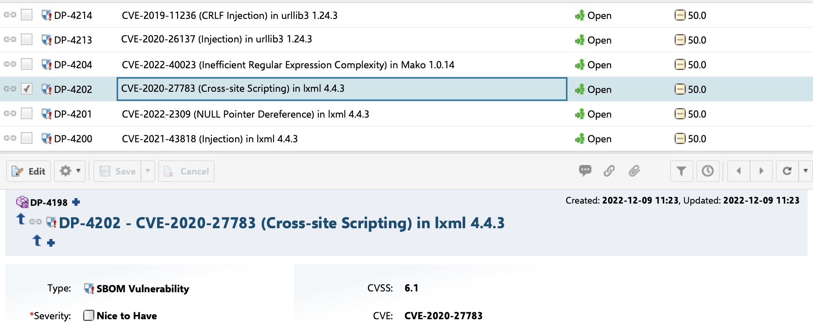

## Integrating Sigrid with Siemens Polarion

Enables synchronization of Sigrid data to [Siemens Polarion](https://polarion.plm.automation.siemens.com). When you
run this integration, the following information will be synchronized to Siemens Polarion:

- Open Source Health (SBOM) components.
- Open Source Health (SBOM) vulnerabilities.
- Security findings in your own code.
- Ratings for maintainability/architecture/OSH/security.

This then allows you to manage Sigrid data in Polarion.

## Prerequisites

- You have [on-boarded your system into Sigrid](../organization-integration/onboarding-steps.md).
- You have a [Sigrid API token](../organization-integration/authentication-tokens.md).
- You have *both* a Polarion development project and a Polarion cybersecurity project.
- You can run this integration in two ways:
    - Using the Docker container in this repository, which requires Docker.
    - By directly running the code in your environment, which requires Python 3.11+.

## Configuration

You need to add this integration to your environment, so that Sigrid data is periodically synchronized to Polarion.
*When* you should schedule this synchronization depends on your development process. For example, if you use a
[nightly build](https://softwareengineering.stackexchange.com/questions/56490/what-does-nightly-builds-mean), it
would be logical to make the Sigrid/Polarion integration part of that nightly build.

As mentioned in the [prerequisites](#prerequisites) section, you can run the integration using Docker. The container
is available from DockerHub: `softwareimprovementgroup/sigrid-integrations`. If you prefer to not use Docker, you
can clone the [Sigrid Integrations repository on GitHub](https://github.com/Software-Improvement-Group/sigrid-integrations/tree/main/polarion-integration)
and run the integration directly.

The integration requires the following environment variables:

- `SIGRID_CI_TOKEN` should be a Sigrid API token that has access to your Sigrid system.
- `POLARION_API_TOKEN` should be a Polarion PAT Token that has access to your Polarion project.

You can then run the integration using the following command line arguments:

| Argument             | Required | Description                                                                     |
|----------------------|----------|---------------------------------------------------------------------------------|
| `--customer`         | Yes      | Your Sigrid customer name, e.g. `mycompany`.                                    |
| `--system`           | Yes      | Your Sigrid system name, e.g. `mysystem`.                                       |
| `--polarionurl`      | Yes      | The base URL for your Polarion instance.                                        |
| `--polarionproject`  | Yes      | The name of the Polarion project that you want to synchronize with Sigrid.      |
| `--systemworkitem`   | Yes      | The ID of the Polarion work item that should act as the "root" for Sigrid data. |

## Usage

When you have successfully completed the steps above, you will start to see work items from Sigrid appear
throughout Polarion in the configured location. These work items are automatically updated whenever you 
publish your source code to Sigrid.

## Contact and support

Feel free to contact SIG’s [support department](mailto:support@softwareimprovementgroup.com) for any questions or 
issues you may have after reading this document.
