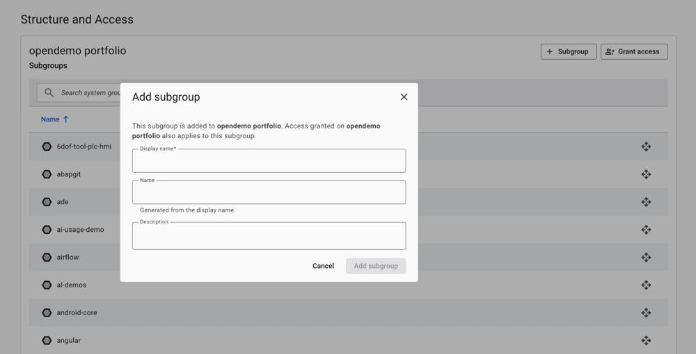
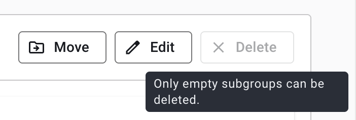

# System groups

**Upcoming:** access management in Sigrid will move to system groups on **30 November 2026**. See [Migrating to system groups](system-groups-migration.md) for what changes for existing users and how to prepare.
{: .attention }

System groups make it possible to organize the systems in a Sigrid portfolio into a hierarchy, one that reflects the organizational structure or any other hierarchy of choice, for example divisions, departments and teams. Every system is part of a group, and groups can contain other groups. System groups offer a new step in navigating and reviewing the software portfolio, as well as a better and easier way to manage access to systems in Sigrid.

Access management is the first feature that is available for system groups. Instead of granting users access to individual systems, access is granted on a group. All users with access to a group automatically have access to the systems and groups below it. When a system is added to a group, the right users can see it straight away. When the organization changes, a system is moved to another group instead of updating permissions one by one. This provides a clearer overview of who has access to what, and takes less effort to keep up to date.

The hierarchy that system groups provide is also the foundation for further capabilities. More features that benefit from system groups will be rolled out in the future, giving better insights across Sigrid.

## The added value of system groups

- **Group-based access:** When a system is added to a group, everyone with access to that group automatically gets access to the system. This enables easier and more consistent access management, at lower effort.
- **Nested structure.** Groups can contain other groups, so you can mirror your organization (for example division > department > team). Access cascades down the hierarchy.
- **Group-level tokens.** Tokens can now be attached to a group instead of a person, so your automations keep working without a dependency on personal tokens. See [group-level tokens](authentication-tokens-group.md).

If you are already using Sigrid, see [migrating to system groups](system-groups-migration.md) to learn what changes for your existing users and roles.

## How system groups work

Your **portfolio** is the top-level group. It contains systems and system groups. A system group can contain systems and other system groups.

```
Portfolio
├── Retail                      (system group)
│   ├── Online shop             (system group)
│   │   ├── webshop-frontend    (system)
│   │   └── webshop-backend     (system)
│   └── Stores                  (system group)
│       └── pos-terminal        (system)
└── Corporate                   (system group)
    └── hr-portal               (system)
```

- **Access cascades down.** A role on a group applies to all systems and groups below it. A role on *Retail* applies to *Online shop*, *Stores* and every system inside them. See [roles and access](system-groups-access.md).
- **Names are unique across the whole portfolio.** This applies to system names and group names together: two systems cannot have the same name (not even in different groups), two groups cannot have the same name, and a system cannot have the same name as a group.
- **A system has exactly one direct parent group.** That parent group can itself be part of a larger hierarchy above it. A system cannot be in two groups at the same time. Moving a system to another group does not change its identity, so Sigrid CI configuration and API integrations keep working.
- **You can nest up to 6 levels deep.**

## System groups versus metadata

System groups launch alongside the existing [system metadata](metadata.md) fields. However, the new organization hierarchy representation that the system groups offer overlaps with the purpose of the Division and Team metadata fields. As a result, the Division and Team metadata fields might be removed in the future. If and when that happens, communication will be shared.

|  | **System groups** | **Metadata (team, division, supplier)** |
| --- | --- | --- |
| Purpose | Organize systems and control access | Describe a system, filter and aggregate in dashboards |
| Who can change it | Admins and Owners of the group | Anyone with edit-access to the system (all roles except Viewer) |
| Used for access | Yes, and access is sticky | Bulk assign only, not sticky |
| Hierarchy | Nested, up to 6 levels | Two fixed levels (division, team) |

## Managing system groups

You manage system groups in **Portfolio settings > Structure and access**. Group management can be performed by Admin users, which always have full permissions on the whole portfolio, and by users with the Owner role on a group. Owners can create and manage the groups they are owner of, as well as sub-groups within those groups.

In the *Structure and access* overview, system groups are indicated by a folder icon () and systems are indicated by a hexagon icon ().

### Create a system group

1. Go to **Portfolio settings > Structure and access**.
2. By default, the overview opens on portfolio level (top-level). If you want to create a system group within deeper existing system groups, first navigate into the existing system group within which you want to create a new group.
3. Click [+ Subgroup], enter a unique name, and save. Note that creating top-level groups (directly in the portfolio) can only be done by Admin users.



A new group is empty. Nobody has access to it except Admins and people who have a role on one of its parent groups, through inheritance.

### Add systems or groups into another group

1. Navigate to the location in the hierarchy where the system or group you want to move is visible.
2. In the row of the item you want to move, click the Move icon ().
3. In the dialog that appears, select into which parent you want to move the item.
4. Save.

Everyone who has access to the selected parent group now has access to the item you moved, with the role they have on the group.

### Create a nested group

Create a group while a parent group is opened, by clicking on the [+ Subgroup] button. People with a role on the parent group automatically get the same role on the new group. *You can give someone a higher role on a sub-group, but not a lower one than they already have via the parent*. See [roles and access](system-groups-access.md#inheritance-of-access).

### Delete a group

System groups can be deleted by portfolio Admin users, or by users with the Owner role for the group to be deleted or any of its parent groups.

Groups must be empty before they can be deleted. Specifically, they can't contain systems or sub-groups, including sub-groups that are empty themselves.

Deleting a group can be done from within the Group detail page, with the buttons at the top of the screen.



Deleting a system group removes the access that came with it. An Owner who deletes the highest-level group they own (only possible when it is empty) loses their Owner rights and cannot create new groups. An Admin must restore access. For now this is the intended behavior.
{: .attention }

## Managing system groups via the API

Because the way permissions are managed changes fundamentally with system groups, the user management API endpoints need to be redeveloped. The endpoints for managing system groups will be released together with system groups. The adjusted user management endpoints will be released soon after, by 7 December 2026.

Documentation for these endpoints will be available as soon as they have been released. For general information about the API, see the [Sigrid API documentation](../integrations/sigrid-api-documentation.md).
