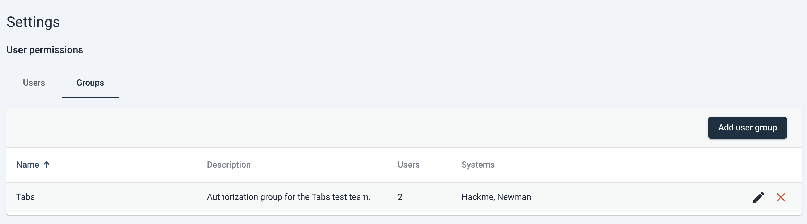
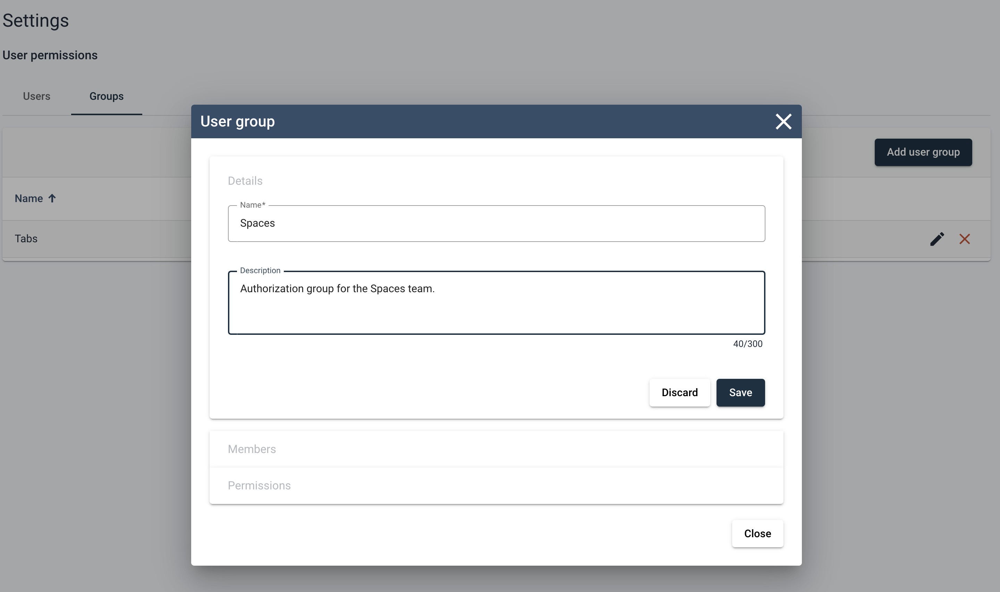
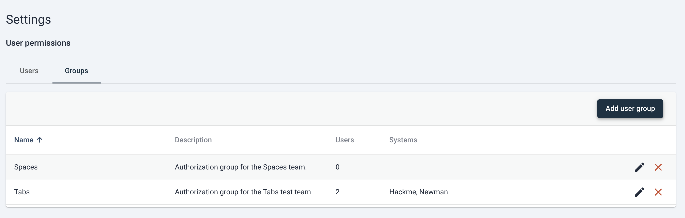
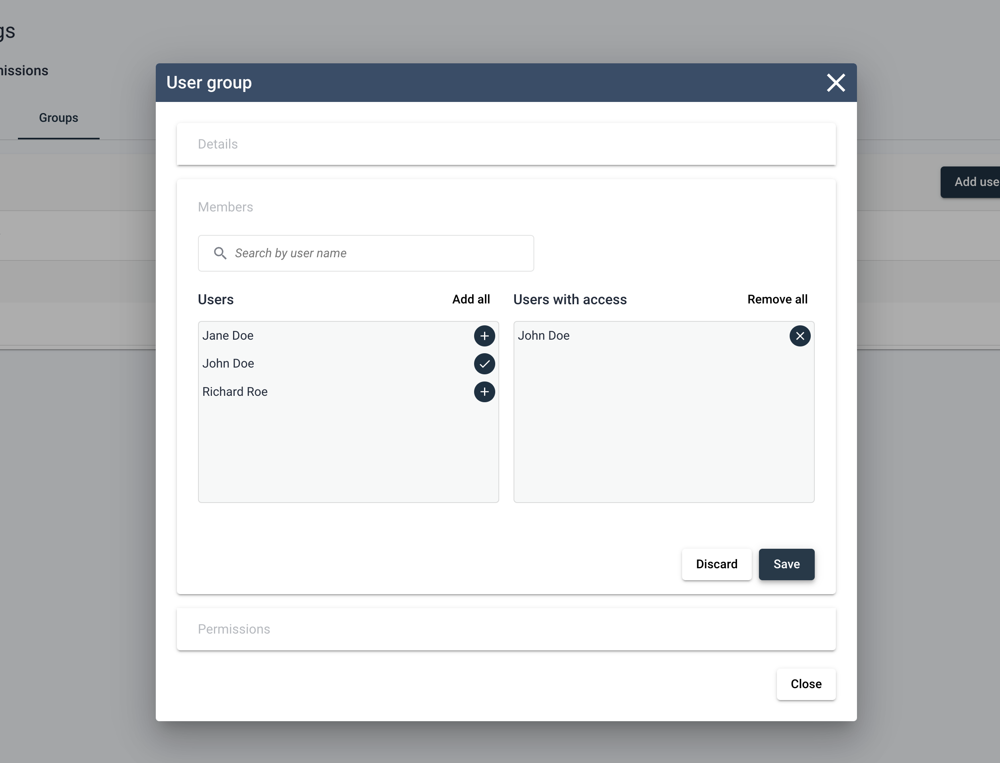

User management in Sigrid
===========================================

This documentation covers cloud-based Sigrid. On-premise Sigrid requires integration with your identity provider, which is explained in the section about [on-premise integration](../organization-integration/onpremise-integration.md).
{: .attention }

When managing user access to Sigrid we need to consider both Authentication (verifying identity) and Authorization (the permissions of that identity). 
- Authentication is performed when users are logging in. This step makes a comparison with what is known about a user e.g. (whether it exists, whether it is active). After Authentication is successful, 
- Authorization determines what that user can see and do.

Sigrid offers two ways of managing Authentication and one type of Authorization. 

This page describes the options and the technical setup.

# Authentication mechanisms

## 1. Using the Sigrid user management module
With this module, a Sigrid administrator can perform all the basic authentication tasks out of the box.

### Note
- That your users will need to set a password.
- Sigrid support can make the use of MFA (multi-factor authentication) mandatory for your users.
- MFA is based on time-based one-time passwords (TOTP), not SMS or email.
- You will need to actively revoke access for users that have left your company by deleting them from user management.

### Sigrid administrator tasks
- Create users based on their email, first and last name.
- Resend lost and temporary passwords.
- Check the last login and MFA status.
- Do authorization tasks to define who can see what in Sigrid.
- Delete users

### Setup customer side
- No setup is needed.

## 2. Using Single Sign On (SSO) with an Identity Provider (IdP)
When Sigrid is linked to your organization's SSO Identity Provider, the user provisioning in Sigrid is done automatically upon login. By default, new users don't see any systems and analysis results yet.
Sigrid supports both SAML or OpenID Connect protocols via a service-provider initiated authentication flow.

### Notes
- With the service-provider initiated authentication flow, users first navigate to `https://<customer>.sigrid-says.com`. They get redirected to their organization's Identity Provider, login there, and then get redirected back to Sigrid.
- SSO improves the ease of use for your colleagues because there is no Sigrid password to remember. 
- SSO improves security because users are created and deleted centrally in your organization.
- Sigrid follows the password policy of your organization.
- SSO integration with Sigrid is **not allowed** when your Identity Provider allows public, self-service sign-up. In other words, all users in your Identity Provider must be associated directly with your organization.

### Sigrid administrator tasks
- Check the last login
- Perform authorization tasks to define who can see what in Sigrid

### Setup on client side

#### SAML Configuration
Create an Enterprise application 'app' in your IdP with the following details: 
- Audience or Identifier (Entity) ID: urn:amazon:cognito:sp:eu-central-1_hwh9zdyCY
- Reply URL: https://auth.sigrid-says.com/saml2/idpresponse

Attributes & Claims:

| Your user | Sigrid expects the long url as SAML attribute name |
| ---------- | ---------- |
| user email | `http://schemas.xmlsoap.org/ws/2005/05/identity/claims/emailaddress` |
| user last name | `http://schemas.xmlsoap.org/ws/2005/05/identity/claims/name` |
| user first name | `http://schemas.xmlsoap.org/ws/2005/05/identity/claims/given_name` |

_Note: if your IdP requires to set an unique user identifier, please choose emailaddress_

Other Settings:
- Signature Algorithm: RSA_SHA256
- Digest Algorithm: SHA256
- Assertion Encryption: unencrypted (privacy is provided by using HTTPS)
- SAML Single Logout: disabled

Assign groups of users to your Authentication app.

#### OpenID Connect Configuration
Create an Enterprise application 'app' in your IdP with the following details:
- Application Type: Web
- Sign in Redirect URI: https://auth.sigrid-says.com/oauth2/idpresponse

Attributes & Claims:
- Okta includes the required claims by default, while Azure/Entra ID does not.
Please check your IdP’s documentation to see if the required claim is included by default or if it needs to be explicitly added.

| Claim | Description | Token Type |
| ---------- | ---------- | ---------- |
| email  | The addressable email for this user, if the user has one | ID |
| family_name | Provides the last name, surname, or family name of the user as defined in the user object | ID |
| given_name | Provides the first or "given" name of the user, as set on the user object | ID |

_Note: For Azure/Entra ID, please check the box "Turn on the Microsoft Graph email, profile permission (required for claims to appear in token)"_

Certificates & Secrets:
- Generate a secret

Other Settings:
- Default

Assign groups of users to your Authentication app.

### Info to provide to SIG
Please send an email to [SIG's support department](mailto:support@softwareimprovementgroup.com) with one of the following url's and if known to you, the relevant Sigrid name.

##### SAML Configuration
The `App federation MetadataURL` of your authentication app.
The information will include your app's identifier, redirectURL etc.

We recommend sending us a Metadata URL, if your SAML provider has a public endpoint. That way, SAML metadata can be refreshed automatically every 6 hours, and there is no need to send a new certificate when it rotates at your provider. If you cannot send us a Metadata URL, a file can be sent instead. However, this file contains an X.509 certificate which has an expiry date (typically several years after creation), so this should be replaced before the X.509 certificate expires, by sending us a new Metadata file.

| IdP | App federation MetadataURL |
| ---------- | ---------- |
| Azure/Entra ID | `https://login.microsoftonline.com/<tenant_id>/federationmetadata/2007-06/federationmetadata.xml?appid=<app_id>` |
| Okta  | `https://<myOktaOrg>.okta.com/app/<app_id>/sso/saml/metadata` |

##### OpenID Connect Configuration
The Application's `client_id`, `client_secret` and the `well-known URI`.
The information in the well-known URI will include your app's issuer, authorization_endpoint etc.

| IdP | Example well-known URI |
| ---------- | ---------- |
| Azure/Entra ID | `https://login.microsoftonline.com/<tenant_id>/v2.0/.well-known/openid-configuration` |
| Okta  | `https://<myOktaOrg>.okta.com/.well-known/openid-configuration` |

### SAML Examples
Please see the separate pages for SAML examples.

- [SAML Azure/Entra ID](usermanagement-example-saml-entraid.md)
- [SAML Google](usermanagement-example-saml-google.md)
- [SAML Okta](usermanagement-example-saml-okta.md)
- [SAML OneLogin](usermanagement-example-saml-onelogin.md)

### OIDC Examples
Please see the separate pages for OIDC examples.

- [OIDC Azure/Entra ID](usermanagement-example-oidc-entraid.md)
- [OIDC Okta](usermanagement-example-oidc-okta.md)

### Deliverables
SIG will set up Single Sign-On (SSO) for you, providing you with a unique, customer-specific URL for Sigrid.
https://customername.sigrid-says.com

# Authorization in Sigrid
While Sigrid requires minimal administration to gather insights in your software's quality, there are a number of tasks that must be performed to ensure your organization gets the most out of their Sigrid experience. Most important of which is the management of other user's access to system details, findings and source code within Sigrid. The following section describes the functions in place to provide this control to users.

### Types of users
Sigrid has two types of users:
- **Normal users:** Can see the systems they have been granted a role on, and can do what that role allows. See [system groups](#system-groups) for the roles.
- **Administrators:** Power users that can manage all users and authorization groups in the portfolio, have access to all systems, and can set portfolio-wide objectives that affect all systems.

Often organizations require a degree of control to prevent improper disclosure of sensitive information between users and teams. Sigrid does this by giving normal users access only to the systems they have been granted a role on. Because administrators can see every system, finding and source code in the portfolio, we recommend keeping the number of administrators small, and using the owner role of a [system group](#system-groups) to delegate the management of a part of the portfolio.

Tasks unique to administrators beyond user management include:
- [Setting and using Sigrid Objectives](../capabilities/objectives.md)
- [Adding business context to a system using metadata](metadata.md)

### Authorized Actions based on User Type

For a full breakdown of what each type of user can do, see the following table. *Note:* These actions refer to both manual actions within the Sigrid web interface as well as actions allowed [via the Sigrid API](../integrations/sigrid-api-documentation.md#managing-individual-user-permissions). The viewer, contributor and owner columns show the role a normal user has on a system. 

| Action                                       | Viewer | Contributor | Owner | Administrator |
|:---------------------------------------------|:------:|:-----------:|:-----:|:-------------:|
| **Portfolio Overview**                       |        |             |       |               |
| View Dashboard                               |   ✅   |     ✅      |  ✅   |     ✅✅      |
| View Systems                                 |   ✅   |     ✅      |  ✅   |     ✅✅      |
| **Capability Specific Overviews**            |        |             |       |               |
| View Dashboards                              |   ✅   |     ✅      |  ✅   |     ✅✅      |
| View Ratings                                 |   ✅   |     ✅      |  ✅   |     ✅✅      |
| Favorite Systems                             |   ✅   |     ✅      |  ✅   |     ✅✅      |
| **Findings and Refactoring Candidates**      |        |             |       |               |
| View Findings                                |   ✅   |     ✅      |  ✅   |     ✅✅      |
| View Finding Audit Trails                    |   ✅   |     ✅      |  ✅   |     ✅✅      |
| Edit Findings                                |        |     ✅      |  ✅   |     ✅✅      |
| Create Manual Findings                       |        |     ✅      |  ✅   |     ✅✅      |
| **Source Code**                              |        |             |       |               |
| View Source Code                             |   ✅   |     ✅      |  ✅   |     ✅✅      |
| **Meta-data**                                |        |             |       |               |
| View metadata                                |   ✅   |     ✅      |  ✅   |     ✅✅      |
| Configure metadata                           |        |             |  ✅   |     ✅✅      |
| **Objectives**                               |        |             |       |               |
| View objectives                              |   ✅   |     ✅      |  ✅   |     ✅✅      |
| Configure system-level objectives            |        |             |  ✅   |     ✅✅      |
| Configure portfolio-level objectives         |        |             |       |     ✅✅      |
| **User Management**                          |        |             |       |               |
| View Users                                   |   ✅   |     ✅      |  ✅   |     ✅✅      |
| Grant and revoke access on a system group    |        |             |  ✅   |     ✅✅      |
| Create / Delete Users                        |        |             |       |     ✅✅      |
| Edit User Details (other than self)          |        |             |       |     ✅✅      |
| View User Status Details                     |        |             |       |     ✅✅      |
| Edit User Role                               |        |             |       |     ✅✅      |
| Reset User Password / MFA                    |        |             |       |     ✅✅      |
| Create / Delete Authorization Groups         |        |             |       |     ✅✅      |
| Edit Authorization Group Members and Details |        |             |       |     ✅✅      |

✅ **Limited Scope:** User is only able to perform this action on the system groups and systems they have been granted the role on, and on everything below those system groups  
✅✅ **Global Scope**: User is able to perform this action across any system in the portfolio

### System groups

System groups are how you decide who can see which systems. Your systems are organized in a tree, and every node in that tree is a system group. If you give someone access to a system group, they get access to everything below it.

Every system group has a type:

- **Portfolio:** The top of the tree, contains both systems and system groups.
- **Subgroup:** A system group that you create yourself to organize your systems, for example per division, department or team. A subgroup can contain other subgroups and systems.
- **System:** The system group that represents one of your systems. Every system in your portfolio has one. Systems are at the bottom of the tree, so they cannot contain other system (groups).

You give access by granting a user (or an [authorization group](#authorization-groups)) a role on a system group. There are three roles:

- **Owner:** Can do what a contributor can, and can also manage the system group itself: create and move subgroups, and decide who has access. For a system, this includes administrative tasks such as [configuring metadata](metadata.md). 
- **Contributor:** Can do what a viewer can, and can also edit findings.
- **Viewer:** Can look at the system, but cannot edit findings.

Roles flow downwards. If you make someone a viewer of a subgroup, they are a viewer of every system in it, including systems that are added later. You do not have to grant access again for every new system.

A few things that are good to know:

- You can combine roles at different levels, for example viewer on a whole department and owner on one team below it. Granting a role that is lower than what someone already inherits is rejected, because it would not change anything.
- Administrators, SIG employees and partner users can already access everything, so you cannot (and do not need to) grant them a role.
- There is no maintainer role. If you want someone to manage access for part of the portfolio, make them the owner of a subgroup.
- You cannot edit or delete the portfolio group or the system groups that represent a system. The technical name of a subgroup cannot be changed after it has been created.

#### Which one should I use?

Grant access as high up in the tree as makes sense, and let inheritance do the rest:

- **A team needs access to all of its systems:** Create a subgroup for the team, put the team's systems in it, and give the team's authorization group a role on the subgroup. When you add a system to the subgroup later, the team can see it without any further changes.
- **One person needs access to one system:** Grant that person a role on the system's own system group. This is also how you change the access of a single person.
- **Someone needs to manage access for part of the portfolio:** Make them the owner of a subgroup.

You can manage system groups in Sigrid and through the Sigrid API. For the API, see [managing system group permissions](../integrations/sigrid-api-documentation.md#managing-system-group-permissions).

### Authorization groups
Authorization groups let administrators manage access for a number of users at once. You put users in an authorization group, and then grant a role on a [system group](#system-groups) to the group as a whole. All members of the group get that role.

#### Creating groups in User Management

You can find the user group table on the User Management page by switching to the "Groups" tab above the User Permissions table.

Creating a new user group is simple. From the "Groups" tab, click the "Add user group" button and this will trigger a new dialog to appear.

From here you can input a descriptive name for the new authorization group as well as a description of the responsibility of this group.

Upon saving of the group details, the authorization group is created. At this state the group will have no users or access to any systems, but the group entity does exist and will populate the User Groups table.

At this point the user is free to delete the group (done via clicking the red "X" icon to the right of the entry in the table) edit the group (via clicking on the pencil icon to the right of the entry in the table).

Switching to the Members section in the edit group dialog, the user can freely allocate group membership to other users within the portfolio. Important to note is that users will only be added to the group when clicking "save", closing the dialog without saving will result in users not being added to the group.

The authorization group does not give access to any system yet. For that, grant the group a role on a [system group](#system-groups).

Some key things to keep in mind when assigning access via authorization groups:
- A role that a user gets through a group is in addition to any role the user has directly. It does not overwrite it.
- Users can be part of multiple groups. A user gets the highest role of everything that applies to them, so overlapping access never causes a problem.
- Access that comes from a group cannot be revoked for a single member. To remove it, either remove the user from the group, or revoke the role of the group.

### User Management via Sigrid API

Apart from the web-based user interface of Sigrid, users and authorization groups can be managed via several endpoints available in the Sigrid API. Please see [how to manage user permission](../integrations/sigrid-api-documentation.md#managing-individual-user-permissions) via API for more information. Access to systems is granted through [system groups](#system-groups); see [managing system group permissions](../integrations/sigrid-api-documentation.md#managing-system-group-permissions).

### Passwords
The administrator can help users by resending a forgotten password or the initial temporary password.
When a user has confirmed their password, they can request a new password themselves.

## Contact and support

Feel free to contact [SIG's support team](mailto:support@softwareimprovementgroup.com) for any questions or issues you may have after reading this documentation or when using Sigrid.
