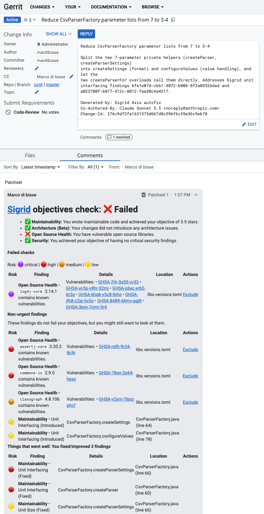

Integrating Sigrid CI with Gerrit
=================================

[Gerrit](https://www.gerritcodereview.com) is a code review platform. Unlike other development platforms (e.g. GitHub),
Gerrit does not include a Continuous Integration pipeline. This means Gerrit is typically used in combination with
a Continuous Integration platform, such as [Jenkins](https://plugins.jenkins.io/gerrit-trigger/).

Since Sigrid CI runs as part of your Continuous Integration pipeline, this makes the integration for Gerrit a bit
different from other platforms:

- Make sure Sigrid CI is integrated into your Continuous Integration pipeline. For example, if you are using Gerrit
  in combination with Jenkins, follow the instructions for [Jenkins](../sigridci-integration/jenkins.md).
- Next, follow the instructions below so that Sigrid CI understands you are using Jenkins in combination with Gerrit.

## Required environment variables

If you add the following environment variables, Sigrid CI will automatically send feedback to Gerrit as part of
every run. Remember, you need to define these environment variables in your Continuous Integration pipeline,
e.g. Jenkins, since that is where Sigrid CI "lives".

| Name                  | Description                                                            |
|-----------------------|------------------------------------------------------------------------|
| `GERRIT_BASE_URL`     | The base URL of the Gerrit server, starting with `https://`.           |
| `GERRIT_REPO`         | The name of the (Git) repository as used within Gerrit.                |
| `GERRIT_BRANCH`       | The branch name of the (Git) repository as used within Gerrit.         |
| `GERRIT_CHANGE_ID`    | The Gerrit change ID for which you are posting feedback.               |
| `GERRIT_USER` [1]     | Credentials for the Gerrit user that will post on behalf of Sigrid CI. |
| `GERRIT_PASSWORD` [1] | Credentials for the Gerrit user that will post on behalf of Sigrid CI. |

[1] Sigrid CI cannot use the newer token-based authentication that was introduced in Gerrit 3.13, to retain
backward compatibility with older Gerrit versions.

## Usage

If you have configured the integration between Sigrid CI, Gerrit, and Jenkins based on the instructions above,
you will automatically receive feedback from Sigrid CI in Gerrit. The feedback is structured as explained in the
[Sigrid CI documentation](../sigridci-integration/using-sigridci.md).

## Contact and support

Feel free to contact [SIG's support team](mailto:support@softwareimprovementgroup.com) for any questions or issues
you may have after reading this documentation or when using Sigrid.
